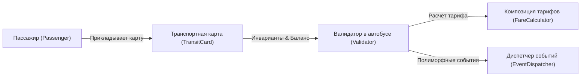

# Руководство студента: Прохождение курса WEBOOP

Добро пожаловать в мини-LMS **WEBOOP**! Этот курс разработан для второкурсников, чтобы освоить объектно-ориентированное программирование на практике за **3 недели**.

Вся система работает **локально прямо в вашем браузере (Local-first)**: вам не нужен удалённый сервер, регистрация или базы данных. Ваш код на Python проверяется моментально прямо в браузере через изолированную среду WebAssembly (Pyodide).

---

## 1. Сквозной сюжет курса: Транспортная система Avtobys

Вместо абстрактных примеров с животными («собаки и кошки») весь курс построен на моделировании реальной системы городского транспорта:

- **Неделя 1 (Инкапсуляция):** Карты `TransitCard` и пассажиры. Защита баланса от отрицательных значений, сокрытие внутреннего состояния, валидация сумм пополнения и списания.
- **Неделя 2 (Наследование против композиции):** Тарифная сетка `FareCalculator`. Почему множественное наследование ломается на комбинациях «студент + пригород + ночной тариф» и как композиция политик решает эту проблему.
- **Неделя 3 (Полиморфизм и протоколы):** Валидаторы и обработка событий `EventDispatcher`. Полиморфная обработка разных типов оплаты (QR-код, физическая карта, льготный проездной) без каскадов `if/elif`.
- **Экзамен (Итоговый практикум):** Поиск и исправление 3 багов в связной транспортной подсистеме с прогоном верификационных тестов.

---

## 2. Как устроен интерфейс

Экран урока разделен на две интерактивные зоны:

1. **Левая панель — Теория и интерактивный UML:**
   - Краткий конспект без воды.
   - Живые UML-диаграммы классов (Mermaid), которые можно визуально изучить перед кодингом.
   - Быстрые контрольные вопросы для самопроверки.
2. **Правая панель — Редактор кода и Терминал:**
   - Редактор с подсветкой синтаксиса Python.
   - Стартовый шаблон кода с подсказками (`TODO`).
   - Кнопка **«Проверить решение»**: код компилируется и проверяется набором скрытых тестов прямо в браузере.
   - Терминал вывода: показывает `stdout/stderr` и статус каждого теста (зеленый/красный).

---

## 3. Индикаторы готовности платформы (Status Bar)

В нижней части экрана находятся системные индикаторы:
- 🟢 **Python Engine (Pyodide):** готов к мгновенному выполнению тестов.
- 🟢 **Local Storage:** весь набранный вами код и баллы сохраняются в браузере автоматически. Если вы случайно обновите страницу (`F5`), ваш код не пропадёт.
- 🟢 **Sandbox Safe:** выполнение кода изолировано и защищено 5-секундным таймером от зависания.

---

## 4. Система оценивания (Шкала 100 баллов)

| Этап | Задания | Баллы |
|---|---|---|
| **Неделя 1** | Практика (15 б.) + Домашнее задание (10 б.) | **25 баллов** |
| **Неделя 2** | Практика (15 б.) + Домашнее задание (10 б.) | **25 баллов** |
| **Неделя 3** | Практика (15 б.) + Домашнее задание (10 б.) | **25 баллов** |
| **Экзамен** | Финальный дебаг-практикум (3 бага) | **25 баллов** |
| **ИТОГО** | | **100 баллов** |

Баллы начисляются автоматически при 100% прохождении тестов к каждому заданию.
