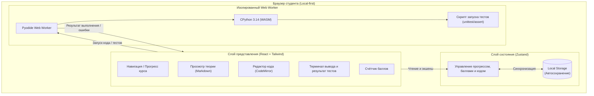
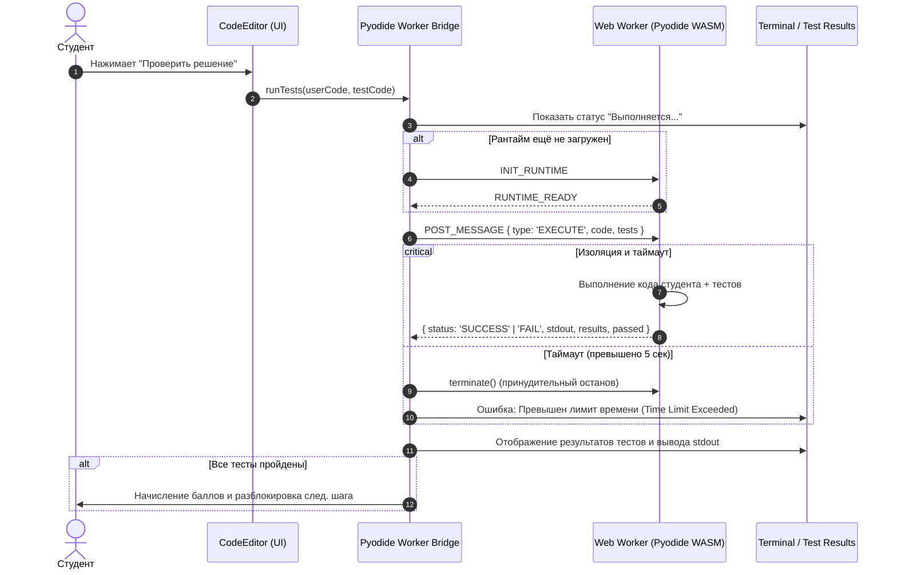
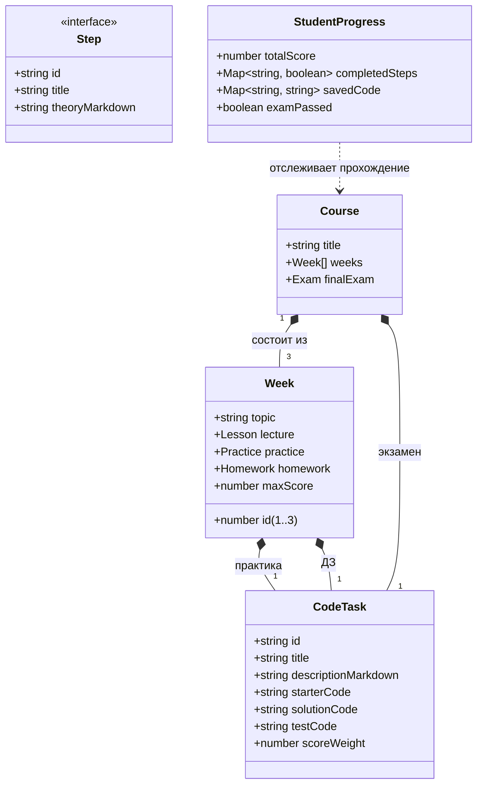

# Архитектура системы WEBOOP

Документ описывает общую архитектуру мини-LMS, модель данных, компоненты и поток данных (Data Flow).

---

## 1. Обзор архитектуры (C4 Component Diagram)

Система построена по клиентской архитектуре (Single Page Application / Local-first) с изоляцией сред выполнения:



---

## 2. Поток выполнения кода и тестов (Sequence Diagram)

Чтобы избежать зависания страницы при ошибках студента (например, бесконечный цикл `while True:`), Python-рантайм вынесен в отдельный поток `Web Worker`:



---

## 3. Модель данных (Data Model / UML Class Diagram)

Модель данных описывает структуру курса, состоящую из 3 недель, шагов и состояния студента:



---

## 4. Структура проекта (Source Tree Proposal)

Для удобства ИИ-агентов структура исходников организована плоско и интуитивно:

```text
WEBOOP/
├── docs/                     # Архитектура, стек, диаграммы (для человека и ИИ)
│   ├── stack.md              # ADR: Выбор технологий
│   └── architecture.md       # C4, Sequence, Class диаграммы
├── src/
│   ├── assets/               # Статические ресурсы (иконки, схемы)
│   ├── components/           # UI компоненты (React)
│   │   ├── layout/           # Sidebar, SplitPane, Header
│   │   ├── editor/           # CodeEditor, Terminal, TestResults
│   │   └── theory/           # MarkdownViewer, Callout
│   ├── content/              # Контент курса (Недели 1-3)
│   │   ├── week-1/           # Инкапсуляция: теория, задачи, тесты
│   │   ├── week-2/           # Наследование и композиция
│   │   ├── week-3/           # Полиморфизм и абстракции
│   │   └── exam/             # Практический экзамен (дебаг кода)
│   ├── store/                # Zustand стор (прогресс, баллы)
│   ├── types/                # Строгие TypeScript интерфейсы
│   └── worker/               # Pyodide Web Worker и мост взаимодействия
│       ├── pyodide.worker.ts # Код воркера
│       └── bridge.ts         # TypeScript обёртка для postMessage с таймаутами
├── index.html
├── package.json
├── tsconfig.json
└── vite.config.ts
```
