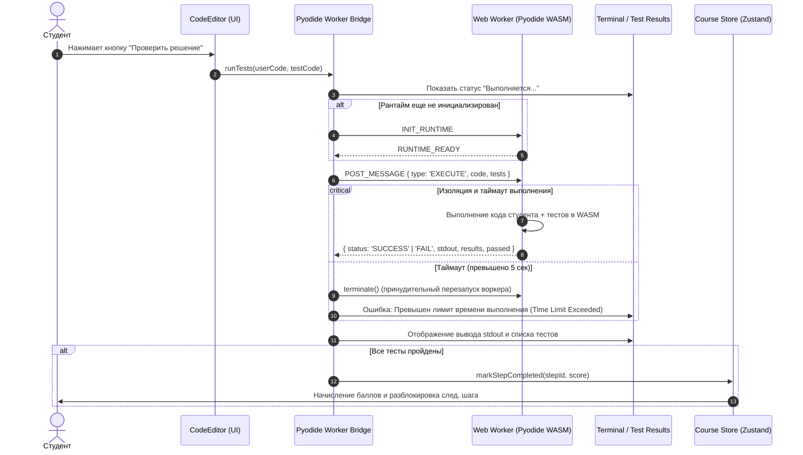

# Поток выполнения и изоляция среды (Execution Flow)

Документ описывает жизненный цикл выполнения кода студента в браузере и протокол взаимодействия с `Pyodide Web Worker`.

## 1. Зачем нужен Web Worker
Запуск Python через Pyodide (WASM) на основном потоке страницы (`Main Thread`) несёт критические риски:
1. Если студент допустит ошибку в логике (например, `while i < 10:` без инкремента `i`), весь интерфейс браузера зависнет намертво. Вкладку придется принудительно закрывать, что приведет к потере несохраненного кода.
2. Инициализация и компиляция Pyodide занимают около 1.8–2.3 с (согласно исследованию `KR-OOP-0001`). Запуск в воркере оставляет UI отзывчивым во время загрузки рантайма.

---

## 2. Диаграмма последовательности (Execution Sequence)


*(Исходный код диаграммы: [`docs/diagrams/sequence-execution.mmd`](../diagrams/sequence-execution.mmd))*

---

## 3. Протокол сообщений между UI и Worker (TypeScript Discriminated Unions)

Взаимодействие строится через строго типизированные сообщения:

### Запросы от UI к Воркеру (`WorkerRequest`):
```typescript
export type WorkerRequest =
  | { type: 'INIT' }
  | {
      type: 'RUN_TESTS';
      taskId: string;
      userCode: string;
      testCode: string;
    };
```

### Ответы от Воркера к UI (`WorkerResponse`):
```typescript
export interface TestCaseResult {
  name: string;
  passed: boolean;
  error?: string;
}

export type WorkerResponse =
  | { type: 'READY' }
  | { type: 'PROGRESS'; stage: 'loading_wasm' | 'running_tests' }
  | {
      type: 'RESULT';
      taskId: string;
      success: boolean;
      stdout: string;
      stderr: string;
      testResults: TestCaseResult[];
      executionTimeMs: number;
    }
  | {
      type: 'ERROR';
      taskId?: string;
      error: string;
    };
```

---

## 4. Механизм защиты от зависания (Timeout Guardian)

В обёртке `WorkerBridge` реализуется сторожевой таймер:
1. При отправке задачи взводится таймер на **5000 мс** (5 секунд).
2. Если ответ от воркера не поступил за 5 секунд:
   - Вызывается метод `worker.terminate()`.
   - Немедленно создаётся новый экземпляр воркера для последующих запусков.
   - Пользователю возвращается ошибка: `TimeLimitExceededError: Решение выполнялось дольше 5 секунд (возможно, бесконечный цикл)`.
