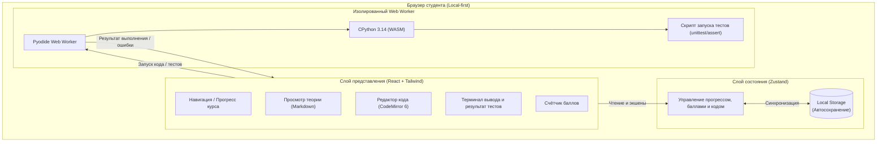

# Общая архитектура системы (Component Overview)

Документ описывает структуру компонентов мини-LMS **WEBOOP**, их ответственность и границы взаимодействия.

## 1. Архитектурные принципы
1. **Client-side Only (Local-first):** Приложение не имеет серверной базы данных. Все вычисления (Python WASM) и хранилище прогресса (`localStorage`) работают в браузере.
2. **Неблокирующий UI:** Выполнение кода студента строго изолировано в отдельном фоновом потоке (`Web Worker`). Любые блокирующие операции (зацикливание, ошибки вычислений) не замораживают пользовательский интерфейс.
3. **Модульность контента:** Учебные материалы (теория, задачи, тесты) представляют собой сериализуемые статические структуры данных, независимые от визуальных компонентов.

---

## 2. Схема компонентов

Диаграмма компонентов отражает разделение приложения на три изолированных слоя: Слой представления (UI), Слой состояния (Store) и Слой выполнения кода (Worker):

*(Исходный код диаграммы: [`docs/diagrams/components.mmd`](../diagrams/components.mmd))*

---

## 3. Описание слоев

### 3.1. Слой представления (UI Layer)
- **`Sidebar`**: дерево курса (Неделя 1..3, Экзамен), статус выполнения каждого шага (иконка статуса), суммарный балл студента.
- **`SplitPane Layout`**: адаптивный двухпанельный интерфейс:
  - Левая панель: теория урока (Markdown, формулы, подсветка блоков кода).
  - Правая панель: интерактивный редактор кода + терминал результатов проверки.
- **`CodeEditor`**: компонент на базе `CodeMirror 6`, обеспечивающий подсветку Python, нумерацию строк, автоотступы (4 пробела).
- **`Terminal / TestResults`**: панель вывода стандартного потока (`stdout/stderr`), а также статуса каждого тест-кейса (пройден / ошибка / ожидаемый вывод).

### 3.2. Слой состояния (Store Layer)
Построен на библиотеке `Zustand` с плагином персистентности:
- Хранит текущий активный шаг (`activeStepId`).
- Хранит пользовательский код для каждой задачи (сохраняется автоматически при вводе, чтобы код не терялся при перезагрузке).
- Хранит историю начисленных баллов и статус сдачи практических заданий и экзамена.

### 3.3. Слой выполнения Python (Worker Layer)
- Загружает скомпилированное ядро `pyodide-core` (версия CPython 3.14 WASM).
- Принимает сообщение с кодом студента и скрытыми тестами.
- Запускает тестовый раннер, перехватывает вывод в `sys.stdout`.
- Возвращает структурированный JSON-ответ с подробным статусом по каждому тесту.
