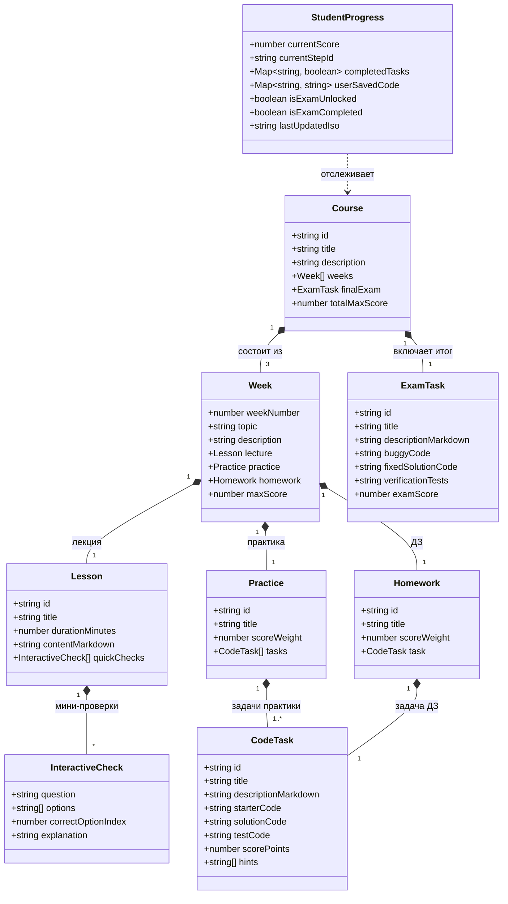

# Доменная модель курса (Course Domain Model)

Документ описывает структуру сущностей образовательного контента мини-LMS **WEBOOP**, правила начисления баллов и модель хранения прогресса студента.

## 1. Концепция курса

Курс рассчитан строго на **3 недели** для второкурсников:
- **Неделя 1:** Классы и объекты, инкапсуляция, сокрытие данных.
- **Неделя 2:** Наследование и композиция, принцип подстановки.
- **Неделя 3:** Полиморфизм, утиная типизация, абстрактные классы (`abc`) и протоколы (`typing.Protocol`).
- **Экзамен:** Практический экзамен на поиск и исправление ошибок в комплексном коде (Debugging & Testing).

---

## 2. Диаграмма классов (UML Class Diagram)


*(Исходный код диаграммы: [`docs/diagrams/domain-classes.mmd`](../diagrams/domain-classes.mmd))*

---

## 3. Модель баллов (Scoring Policy)

Максимальная сумма за курс: **100 баллов**.

| Раздел | Элемент | Максимальный балл | Описание |
|---|---|---|---|
| **Неделя 1** | Практика (Задачи 1–2) | 15 баллов | Проверка базового класса и инвариантов |
| **Неделя 1** | Домашнее задание | 10 баллов | Реализация закрытых полей и валидации |
| **Неделя 2** | Практика (Задачи 1–2) | 15 баллов | Наследование и композиция компонентов |
| **Неделя 2** | Домашнее задание | 10 баллов | Выделение интерфейса через композицию |
| **Неделя 3** | Практика (Задачи 1–2) | 15 баллов | Полиморфный обработчик |
| **Неделя 3** | Домашнее задание | 10 баллов | Абстрактные фабрики / классы |
| **Экзамен** | Финальный багфикс-тест | 25 баллов | Найти и устранить 3 логические ошибки в кодовой базе проекта |
| **ИТОГО** | | **100 баллов** | |

---

## 4. Канонические TypeScript-интерфейсы

Любой компонент или парсер контента должен использовать эти типы (файл `src/types/course.ts`):

```typescript
export interface InteractiveCheck {
  id: string;
  question: string;
  options: string[];
  correctOptionIndex: number;
  explanation: string;
}

export interface Lesson {
  id: string;
  title: string;
  durationMinutes: number;
  contentMarkdown: string;
  quickChecks: InteractiveCheck[];
}

export interface CodeTask {
  id: string;
  title: string;
  descriptionMarkdown: string;
  starterCode: string;
  testCode: string;
  scorePoints: number;
  hints?: string[];
}

export interface WeekModule {
  weekNumber: 1 | 2 | 3;
  topic: string;
  description: string;
  maxScore: number;
  lecture: Lesson;
  practiceTasks: CodeTask[];
  homeworkTask: CodeTask;
}

export interface ExamModule {
  id: 'final-exam';
  title: string;
  descriptionMarkdown: string;
  buggyCode: string;
  testCode: string;
  examScore: 25;
}

export interface StudentProgressState {
  currentScore: number;
  currentStepId: string;
  completedTasks: Record<string, boolean>;
  userSavedCode: Record<string, string>;
  isExamUnlocked: boolean;
  isExamCompleted: boolean;
  lastUpdatedIso: string;
}
```
