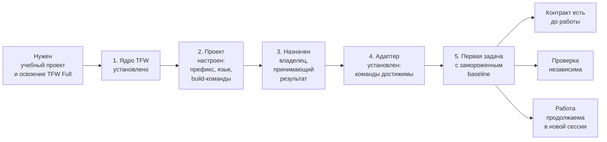

# HL — OOP_20261007-230107_TFS: TFW Full setup for the OOP mini-LMS

> **Current filename**: `HL-OOP_20261007-230107_TFS.md`
> **Date**: 2026-10-07
> **Author**: Coordinator (dsh:session:local:weboop-init-20261007)
> **Title**: TFW Full setup for the OOP mini-LMS
> **Abbreviation**: TFS
> **Status**: 🔒 FROZEN — approved by zhassulan 2026-10-07
> **Contract**: 🔒 FROZEN — approved by zhassulan 2026-10-07
> **Frozen**: §1 · §3 · §4 · §5 · §6 · §7 — locked on owner approval
> **Free**: §2 · §7.2 · §8 · §9 · §10 · §11 — research updates these directly
> **Append-only**: §12 Amendment Log — the only channel for changing a frozen section
> **Baseline**: freeze commits — recovery form in `conventions.md` §3 rule 15

> **Project North Star**: `README.md § Зачем этот проект` · `README.md § Что проект не должен делать`

---

## 1. Vision 🔒 FROZEN

Проект WEBOOP запускается как ведомый TFW Full: у него есть утверждённый владелец, проверяемый
замороженный baseline, установленный адаптер и явный жизненный цикл задач. После этого ни одна
последующая задача не начинается с чата без контракта.

**Impact:** Каждая следующая задача получает проверяемую точку отсчёта, маршрут к владельцу и
явные статусы вместо контекста, живущего только в переписке. Автор проекта получает рабочий пример
полного цикла TFW, который он обязан уметь читать и править.

> «Раньше я держал весь план в голове и в переписке. Теперь я открываю каталог задачи и вижу, что
> решено, на каком основании, что проверено и что делать дальше — и могу показать это преподавателю.»

> **Граница цели.** §1 описывает цель **этой задачи** — привести проект в рабочее состояние TFW Full.
> Цель продукта (курс по ООП) живёт в Project North Star. Реализация курса в объём этой задачи не
> входит: здесь фиксируются только его согласованные границы.

## 2. Current State (As-Is) 🟢 FREE

Наблюдения из фактического состояния каталога проекта на 2026-10-07:

- Каталог проекта был пуст; продуктового кода, тестов и истории Git не существовало.
- Ядро TFW Full 3.9.0 получено из `https://github.com/saubakirov/trace-first-starter@v3.9.0`
  (sparse-клон: только `.tfw` и `editions`; `size-pack` 867.53 KiB) и скопировано в `.tfw/`
  без проектного состояния источника: исключены `project_config.yaml`, `knowledge_state.yaml`
  и `update_receipts/`. Проверено: 103 файла, чистый шаблон `templates/project_config.yaml`
  сохранён (5446 байт).
- Владелец подтвердил в одном обмене: префикс `OOP`, аббревиатуру `TFS`, язык содержимого `ru`,
  codex-совместимый layout адаптера и completion checks `npm run build && npm test`.
- Профиль владельца создан без фамилии: `handle: zhassulan`, `name: Жасулан`. Поле `name` —
  неполное (см. §9 R1).
- **Неизвестно:** стек технологий мини-LMS, модель автоматической проверки кода студентов,
  архитектура продукта. Эти решения относятся к продуктовым задачам, а не к этой.
- **Решено владельцем 2026-10-07 (до заморозки):** объём курса — три недели с темами «Классы и
  объекты, инкапсуляция», «Наследование и композиция», «Полиморфизм и абстракции»; формат экзамена —
  практическое задание на поиск и исправление ошибок в коде с проверкой тестами. Записано в
  `README.md § Содержание курса`.
- **Ограничение среды:** `git` на этой машине не работает через TLS-бэкенд `schannel`
  (`SEC_E_NO_CREDENTIALS`); HTTPS работает только с `http.sslBackend=openssl`. Временный каталог
  DSH очищается между прогонами, поэтому исходный клон недолговечен.

Продуктовая архитектура не спроектирована: это решение не относится к данной задаче и будет
принято отдельно.

## 3. Target State (To-Be) 🔒 FROZEN

Настроенный проект TFW Full, в котором инициализация выполнена до конца: конфигурация, владелец,
адаптер, запись знания и первая задача с проверяемым baseline.

**Границы курса зафиксированы** в `README.md § Содержание курса`: три недели, темы «Классы и
объекты, инкапсуляция» → «Наследование и композиция» → «Полиморфизм и абстракции»; нагрузка 1 ч
лекции + 1 ч практики + ~1 ч домашней работы в неделю; экзамен — практическое задание на поиск и
исправление ошибок в коде с проверкой тестами; вне объёма — исключения, файлы, многопоточность,
SOLID и паттерны. Эта задача **не реализует** курс, а передаёт его согласованные границы
продуктовой задаче и не дублирует содержание курса в HL.

| Область | Как есть (As-Is) | Как будет (To-Be) |
|---|---|---|
| Конфигурация | нет `.tfw/project_config.yaml` | конфиг получателя: `task_prefix: OOP`, `content_language: ru`, `task_containers: [workspace]`, реальные build-команды |
| Владелец | нет `team/` | профиль человека `team/zhassulan.md` |
| Инструкции ИИ | нет `AGENTS.md` | управляемый блок TFW из шаблона адаптера, проектный текст не перезаписан |
| Адаптер | нет `.agents/skills/` | `.agents/skills/tfw-*/SKILL.md` по всем 11 записям манифеста |
| Знание | нет `KNOWLEDGE.md` | чистая запись из шаблона, без выдуманных фактов |
| Задача | нет | `workspace/2026/OOP_20261007-230107_TFS/` со `status.md`, `journal/`, `evidence/` |
| Baseline | нет Git | репозиторий; замороженный HL закоммичен, `coordination_authority` указывает на реальный коммит |

### 3.1 Result Visualization

Шесть месяцев спустя владелец открывает каталог проекта и видит следующее.

```
WEBOOP/
├── AGENTS.md                     ← управляемый блок TFW + проектные инструкции
├── README.md                     ← Project North Star: зачем, содержание курса, чего не делать
├── KNOWLEDGE.md                  ← вход в проверенное знание
├── .tfw/                         ← ядро Full 3.9.0 (VERSION=3.9.0)
│   ├── project_config.yaml       ← OOP · ru · [workspace] · build: npm run build && npm test
│   ├── workflows/                ← plan, research, handoff, review, init, config, ...
│   └── templates/                ← формы HL, RES, TS, ONB, RF, REVIEW, EV
├── .agents/skills/
│   ├── tfw-plan/SKILL.md         ← 11 команд: plan, research, handoff, review, docs,
│   ├── tfw-handoff/SKILL.md         knowledge, release, update, config, init, economics
│   └── ...                       ← маршрутизаторы к .tfw/workflows/*
├── team/
│   └── zhassulan.md              ← владелец: человек, принимающий результат
└── workspace/2026/
    └── OOP_20261007-230107_TFS/          ← эта задача
        ├── status.md                       ← lifecycle + все 9 полей маршрутизации
        ├── HL-OOP_20261007-230107_TFS.md   ← замороженный контракт
        ├── RF__OOP_20261007-230107_TFS.md  ← что фактически сделано
        ├── REVIEW__OOP_20261007-230107_TFS.md ← независимая проверка
        ├── journal/                        ← created, transition, ... (неизменяемые)
        ├── evidence/                       ← EV: чем именно подтверждено
        └── research/iter1/                 ← briefing → gather → extract → challenge → RES
```

| Что изменилось | Ценность для владельца |
|---|---|
| Появился `status.md` с маршрутом к владельцу | видно, кто принимает решение и на каком основании |
| Появился замороженный HL | «что считаем сделанным» зафиксировано до работы, а не после |
| Появился `evidence/` | каждое утверждение о готовности подкреплено командой и её выводом |
| Появился `journal/` | история решений неизменяема, её нельзя тихо переписать |

*Иллюстративные данные: дерево показывает целевое состояние, а не уже существующие файлы; на момент
написания существуют `.tfw/`, `.agents/`, `AGENTS.md`, `README.md`, `KNOWLEDGE.md`, `team/` и
каталог задачи с черновиком HL.*

### 3.2 Value Flow



Каждый шаг создаёт отдельную ценность: без шага 2 задачи некуда создавать; без шага 3 некому
принимать результат; без шага 4 работу нельзя запускать повторно; без шага 5 нет точки отсчёта,
относительно которой проверяется объём.

## 4. Phases 🔒 FROZEN

Однофазная задача. Одна задача — один цикл TS → RF; дробление не требуется, потому что
`scope_budgets` (50 файлов / 5000 строк) не достигаются.

### 4.1 Coordination Selection 🔒 FROZEN

| Activation source | Accountable owner | Task Coordinator unit | Phase Coordinator rule | Mandate scope / role reach | Upward route | Dialogue | Reporting | Reservations / controls | Amendment authority | Immutable epoch |
|---|---|---|---|---|---|---|---|---|---|---|
| owner-direct | zhassulan | `dsh:session:local:weboop-init-20261007` | none (single phase) | setup, config, adapters, and this task's RES/RF only | owner:zhassulan | tfw-gates-only | native-gates | owner reserves: project purpose, frozen claims, adapter selection, task title and abbreviation, course scope, stack choice, scope acceptance; no agent may widen its own grant | none | `HL-OOP_20261007-230107_TFS.md` @ pending-baseline-freeze |

> Activation is owner-direct: no agent principal, delegation or mandate is invented. The Coordinator
> unit address is the local DSH session acting for the owner; it is operational trace in `status.md`,
> not a frozen roster row.

### Phase A: Project setup and first contract baseline 🔴

- Конфигурация получателя `.tfw/project_config.yaml` с префиксом `OOP`, языком `ru`, `[workspace]`
  и реальными build-командами.
- Профиль владельца `team/zhassulan.md`.
- Корневой Project North Star в `README.md`: что строим, содержание курса, чего не делаем.
- Чистая запись `KNOWLEDGE.md` из шаблона.
- Управляемый блок TFW в `AGENTS.md` и полный набор команд адаптера `.agents/skills/tfw-*/SKILL.md`.
- Каталог задачи `workspace/2026/OOP_20261007-230107_TFS/` со `status.md`, `journal/`, `evidence/`.
- Замороженный HL и закоммиченный baseline с разрешимой ссылкой `coordination_authority`.
- Инициализационное исследование `research/iter1/` (briefing → gather → extract → challenge → RES),
  обязательное по `.tfw/workflows/init.md` Step 3 и утверждённое владельцем 2026-10-07 (см. §12 A1).

## 5. Definition of Done (DoD) 🔒 FROZEN

- ✅ 1. `.tfw/project_config.yaml` существует и семантически валиден: `task_prefix: OOP`,
  `content_language: ru`, `task_containers: [workspace]`, `build.lint` и `build.test` содержат
  реальные команды, а не заглушки.
- ✅ 2. `.tfw/VERSION` (`3.9.0`) согласован с `tfw.version` в конфиге.
- ✅ 3. `team/zhassulan.md` существует, объявляет `type: human` и содержит обязательные ключи
  `handle`, `name`, `type`, `since`.
- ✅ 4. `README.md` содержит designated Project North Star: цель продукта, содержание курса и
  раздел «чего не делать», а также прямые маршруты к методу, знанию и выбранному следу задачи.
- ✅ 5. `KNOWLEDGE.md` создан из чистого шаблона и не содержит выдуманных фактов или
  поддерживаемого перечня задач.
- ✅ 6. `AGENTS.md` содержит управляемый блок TFW; существующий проектный текст не перезаписан.
- ✅ 7. Все 11 записей команд манифеста установлены по точным целевым путям
  `.agents/skills/tfw-{command}/SKILL.md`, каждая разрешается в свой канонический workflow.
- ✅ 8. Каталог задачи содержит `status.md` с полным набором из девяти полей маршрутизации, а также
  `journal/` и `evidence/`.
- ✅ 9. Жизненный цикл этой задачи доведён до `RF` с соответствующим событием перехода.
- ✅ 10. HL заморожен (`🔒 FROZEN — approved by zhassulan`), закоммичен, и
  `coordination_authority` в `status.md` ссылается на реальный разрешимый коммит.
- ✅ 11. Повторная установка адаптера не даёт нового diff (идемпотентность).
- ✅ 12. Инициализационное исследование завершено: `research/iter1/` содержит все стадии и `RES.md`,
  а `RES.md` отвечает на гипотезы H1–H5.

## 6. Definition of Failure (DoF) 🔒 FROZEN

- ❌ 1. Инициализация выполнена поверх уже настроенного состояния или проектный текст перезаписан.
- ❌ 2. Значения (префикс, язык, адаптер, идентичность, время, аббревиатура) придуманы, а не
  утверждены владельцем.
- ❌ 3. Адаптер подтверждён только наличием файлов, без разрешения ссылок и ролей.
- ❌ 4. `status.md` записан с выдуманным, неполным или неразрешимым `coordination_authority`.
- ❌ 5. В `.tfw/` попало проектное состояние источника (живой `project_config.yaml`,
  `knowledge_state.yaml`, `update_receipts/`) или утрачен чистый шаблон конфига.
- ❌ 6. `build.lint` или `build.test` остались заглушками: build-гейт исполнителя тогда ничего
  не проверяет.
- ❌ 7. Задача объявлена `DONE` без независимого review и без заполненного `outcome`.
- ❌ 8. Задача вышла за свою границу и начала проектировать продукт: выбран стек, нарисована
  архитектура курса или написан код мини-LMS.

**On failure:** остановиться, не перезаписывая существующее состояние. Владелец решает: повторить
инициализацию на чистом каталоге, принять состояние как есть и перейти к attach/repair, или
отклонить результат. Любое из решений фиксируется событием в `journal/`.

## 7. Principles 🔒 FROZEN

1. **Один источник правил** — `.tfw/conventions.md` остаётся единственным владельцем формальных
   правил; проектные документы на него ссылаются и его не пересказывают.
2. **Язык содержимого** — русский для проектного и учебного текста; имена файлов, ключи и
   структурные идентификаторы остаются такими, как их определяет framework.
3. **Никаких выдуманных данных** — идентичность, время, аббревиатура и ссылки на коммиты берутся
   из факта или не записываются вовсе.
4. **Реальные команды вместо заглушек** — `build.lint` и `build.test` должны выполняться.
5. **Минимум церемонии, достаточный для полноты** — форма сокращается только там, где это не
   вредит цели, корректности, наблюдаемости или продолжению работы.
6. **Среда названа честно** — расхождения между документированным маршрутом и фактической средой
   (сломанный `schannel`, отсутствие адаптера DSH в манифесте) фиксируются, а не замалчиваются.
7. **Задача настройки не проектирует продукт** — выбор стека, архитектура курса и код мини-LMS
   относятся к отдельным задачам с собственными HL. Здесь фиксируются только согласованные
   границы курса, чтобы продуктовая задача имела вход, и ничего больше.

## 7.1 Quality Contract 🔒 FROZEN

- Проектный и учебный текст — на русском; структурные ключи не переводятся.
- `.tfw/` не редактируется вручную: изменения ядра приходят только через `/tfw-update`.
- Обязательные фразы-шаблоны артефактов (например, строка состояния задачи) сохраняются дословно.
- Коммиты используют грамматику `[agent/task/scope/role] summary` из `conventions.md` §4.
- Секреты, ключи и `.user_preferences.md` не попадают в репозиторий.

### 7.2 Knowledge Citations 🟢 FREE

| # | Source | Item | How it applies |
|---|--------|------|----------------|
| 1 | `README.md` (P0) | `§ Зачем этот проект` — цель продукта: короткий курс по ООП для второго курса, локально, с баллами; цель автора вынесена отдельно как не-свойство продукта | Задаёт назначение продукта; проверка Purpose Check опирается на этот раздел |
| 2 | `README.md` (P0) | `§ Что проект не должен делать` — не промышленная LMS, не облако, не сборник демо | Ограничивает объём: любая задача, добавляющая администрирование или деплой, противоречит P0 |
| 3 | `.tfw/README.md` `Methodology values` (P1) | Candor Over Flattery; Structural Enforcement; Portability | Объясняет, почему состояние живёт в обычных файлах и почему расхождения среды сообщаются прямо |
| 4 | `.tfw/README.md` `Success Criteria` (P1) | Возобновление с durable checkpoint; прослеживаемость решений; готовность к приёмке | DoD §5 формулирует эти критерии как проверяемые пункты |
| 5 | `KNOWLEDGE.md` §1 (P3) | «No project components have been recorded yet» | Проект в фазе bootstrap: архитектура продукта ещё не зафиксирована |
| 6 | `.tfw/conventions.md` (P4) | `Required Artifacts (project root)`; `HL Contract`; `Task Statuses` | Определяет обязательный набор файлов, заморозку §1·§3–§7 и набор из девяти полей статуса |

## 8. Dependencies 🟢 FREE

| Dependency | Status |
|------------|--------|
| Git ≥ 2.51 в проекте | ✅ инициализирован, ветка `main`, три baseline-коммита |
| Доступ к HTTPS с `http.sslBackend=openssl` | ✅ подтверждено (клон v3.9.0 выполнен) |
| Шаблоны ядра `.tfw/templates/` | ✅ установлены (26 файлов, включая `project_config.yaml`) |
| Решение владельца по объёму курса и формату экзамена | ✅ принято 2026-10-07, записано в `README.md` |
| Выбор стека технологий мини-LMS | ⬜ не сделан; блокирует первую продуктовую задачу, не эту |
| Node.js и npm для `npm run build && npm test` | ⬜ не подтверждено; станет проверяемым после выбора стека |

## 9. Risks 🟢 FREE

| Risk | Probability | Impact | Mitigation |
|------|-------------|--------|------------|
| R1: `team/zhassulan.md` содержит только имя, без фамилии | High | Low | Поле `name` помечено как неполное в §2; владелец может уточнить имя отдельной правкой |
| R2: временный каталог DSH очищается между прогонами | High | Medium | Ядро уже скопировано в проект; при потребности клон восстанавливается одной командой |
| R3: адаптер DSH отсутствует в манифесте, `/tfw-*` не станут нативными слэш-командами | High | Low | Снят практикой: 11 команд обнаружены сессией как skills через `AGENTS.md` → `.agents/skills/` |
| R4: `npm run build && npm test` невыполнимы, пока стек не выбран | High | Medium | Зафиксировано в §8; команды станут проверяемыми после выбора стека |
| R5: объём full-церемонии превышает бюджет учебного проекта | Medium | Medium | §7 п.5: сокращать форму только там, где это не вредит цели и корректности |
| R6: сломанный TLS-бэкенд `schannel` может проявиться при `/tfw-update` | Medium | Medium | `http.sslBackend=openssl` прописан в `.git/config` проекта |
| R7: у автора нет опыта проверки чужого кода, а автопроверка кода студентов это подразумевает | Medium | High | Исследование H2–H4 явно проверяет, какие модели проверки реализуемы без серверного исполнения кода |
| R8: балльная система может потребовать учёта пользователей, что противоречит P0 | Medium | Medium | Гипотеза H5 проверяет достаточность локальной модели без аутентификации |

## 10. RESEARCH Case 🟢 FREE

### Blind Spots

- Нет подтверждённой модели автоматической проверки кода студента в браузере для Python.
- Нет данных, укладывается ли заявленный объём (1 ч лекции + 1 ч практики + 1 ч ДЗ в неделю) в
  три недели без потери целостности курса.
- Не выбран стек, поэтому неясны ограничения по запуску «локально, без деплоя».
- Не определено, как начислять баллы без учётных записей студентов.

### Hypotheses

| # | Hypothesis | Status |
|---|----------|--------|
| H1 | Три недели достаточны для целостного вводного курса по ООП, если ограничиться классами, инкапсуляцией, наследованием и полиморфизмом | open |
| H2 | Автоматическая проверка кода студентов достижима локально без серверного исполнения кода | open |
| H3 | Существующая песочница (например, Pyodide) снимает необходимость писать собственный исполнитель | open |
| H4 | Статический анализ + тесты дают студенту достаточную обратную связь без запуска произвольного кода | open |
| H5 | Балльная система без аутентификации достаточна для локального учебного курса и не противоречит P0 | open |

### Risks of Not Researching

Без исследования высок риск выбрать стек и модель проверки кода, которые не запускаются локально
или требуют серверного исполнения чужого кода. Переделка на этапе реализации обойдётся дороже, чем
ограниченное исследование сейчас.

### Proposed RESEARCH Focus

1. **Gather**: какие подходы к локальной проверке кода студентов существуют и какие ограничения
   у каждого (Pyodide, WebContainers, статический анализ).
2. **Extract**: какие темы ООП реально укладываются в три недели по одному часу лекций и практики.
3. **Challenge**: какие из вариантов проверки кода ломаются при запуске строго локально, без деплоя.

### Why Not Just...?

| Approach | Value | Adoption / operating burden | Risks / tradeoffs | Decision and reason |
|---|---|---|---|---|
| Внедрить TFW Full и настроить проект (рекомендуется) | Явный контракт, владелец, доказательства и продолжение работы в новой сессии | Первая задача даёт больше документов, чем кода | Церемония выше, чем требует объём продукта | Рекомендуется: изучение Full — прямо заявленная цель учебного задания |
| Начать сразу с кода и добавить следы позже | Быстрее видимый результат сайта | Дешевле на старте | Решения и их основания теряются; «позже» обычно не наступает; переделка baseline дороже | Отклонено: противоречит заявленной цели освоить Full |
| Взять TFW Assisted 1.6 | Быстрее к работающему сайту, дружелюбнее к человеку | Ниже | Скрывает внутренние форматы и не даёт полного жизненного цикла | Отклонено: критерий задания — читать и править архитектуру, а Assisted намеренно её скрывает |

**Leave unchanged:** без настройки TFW проект остаётся набором решений в переписке; автор не сможет
показать преподавателю прослеживаемость и не получит требуемого навыка работы с Full.

**Critical challenge:** сильнейшее возражение — что полная церемония Full не окупается на проекте
масштаба трёхнедельного курса, и время уйдёт на документы вместо работающего сайта. Рекомендация
была бы неверной, если бы целью было только работающее приложение. Её спасает то, что целью задания
заявлено освоение Full и умение читать архитектуру. Неразрешённая гипотеза: сколько времени реально
займёт первая задача (см. §9 R5).

## 11. Strategic Insights (Planning) 🟢 FREE

| # | Insight | Category | Source |
|---|---------|----------|--------|
| S1 | Проект решает две задачи одновременно: учебный продукт и учебный полигон для освоения TFW Full; выбор редакции определяется второй задачей, поэтому цель автора вынесена из §1 и не входит в Project North Star | Приоритеты | User, постановка проекта |
| S2 | Главный критерий приёмки задания — не только работающий сайт, но и способность автора читать структуру и вносить небольшую правку | Критерии приёмки | User, постановка проекта |
| S3 | Сайт должен работать локально, без деплоя; это ограничение, а не временное упрощение | Ограничение среды | User, постановка проекта |
| S4 | Нагрузка курса жёстко ограничена: 1 ч лекций + 1 ч практики + 1 ч домашней работы в неделю | Ограничение объёма | User, постановка проекта |
| S5 | Владелец выбрал формат экзамена сознательно: поиск и исправление ошибок в коде проверяет понимание, а не память, и переиспользует механизм проверки кода из курса | Продуктовое решение | User, решение 2026-10-07 |
| S6 | Владелец предпочёл зафиксировать объём курса в README, а не дублировать его в HL, чтобы у продукта был один источник содержания | Процесс | User, решение 2026-10-07 |

## 12. Amendment Log 🟢 APPEND-ONLY

| # | Date | § | Type | Proposer | Proposed change | Evidence | Cost | Alternatives considered | Verdict |
|---|------|---|------|----------|-----------------|----------|------|------------------------|---------|
| A1 | 2026-10-07 | §4 Phase A | `EXTEND` | coordinator | Включить инициализационное исследование `research/iter1/` в объём задачи как отдельный deliverable фазы | `.tfw/workflows/init.md` Step 3 требует запустить `/tfw-research` внутри задачи инициализации | Один цикл исследования до закрытия задачи | Не включать исследование; отклонено, так как `init.md` прямо назвал его обязательным этапом | `✅ APPROVED — zhassulan, 2026-10-07 (pre-freeze; applied to §4 Phase A, DoD 12 aligned)` |

> **Замечание о порядке.** A1 был предложен и разрешён **до** заморозки HL, когда §1·§3–§7 ещё не
> были заморожены. По `conventions.md` → `HL Contract` правило 3 канал §12 обязателен только для
> правки **замороженного** раздела, поэтому правка внесена напрямую, а строка сохранена как
> письменная запись решения владельца. После заморозки любое изменение этих разделов идёт только
> через §12.

### Material handover at this return

- **Producer/unit:** Coordinator, `dsh:session:local:weboop-init-20261007`.
- **Inspected scope:** `.tfw/` (ядро 3.9.0), `editions/README.md` и `editions/02-assisted/`,
  `.tfw/templates/{project_config,status,journal/event,HL,team/profile}.md`,
  `.tfw/adapters/manifest.yaml`, `.tfw/adapters/codex/AGENTS.md.template`, `.tfw/workflows/init.md`,
  `conventions.md` §3–§5; фактическое состояние каталога проекта.
- **Material:** ограничения среды (§2, §9 R2–R3, R6); отсутствие стека (§8, §9 R4); неполное имя
  владельца (§2, §9 R1); отсутствие опыта проверки кода (§9 R7).
- **Uncertainty:** выбор стека и модели проверки кода — вынесены в гипотезы H1–H5 (§10).
- **Continuation:** ожидается решение владельца по пересмотренным §1, §3, §4, §5, §6, §7; после
  утверждения HL замораживается и коммитится, затем выполняется инициализационное исследование.

---

*HL — OOP_20261007-230107_TFS: TFW Full setup for the OOP mini-LMS | 2026-10-07*
