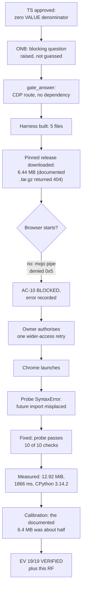

# RF — OOP_20261007-230107_TFS: Verify the TFW Full setup with measured evidence

> **Current filename**: `RF__OOP_20261007-230107_TFS.md`; later rounds append to this file.
> **Date**: 2026-10-07
> **Author**: Executor (dsh:session:local:weboop-init-20261007)
> **Status**: 🟢 RF — Complete
> **Parent HL**: [HL-OOP_20261007-230107_TFS.md](HL-OOP_20261007-230107_TFS.md)
> **TS**: [TS__OOP_20261007-230107_TFS.md](TS__OOP_20261007-230107_TFS.md)
> **Producer unit**: `dsh:session:local:weboop-init-20261007`
> **Parent Coordinator**: `dsh:session:local:weboop-init-20261007`
> **Activation / dispatch source**: owner-direct (owner `zhassulan`, approved TS 2026-10-07)
> **Coordination authority**: `HL-OOP_20261007-230107_TFS.md @ 3f5eff6f5e87f4afcc401f29aab8c5b4dfd83426`
> **Originating proposer**: none (owner-direct — no agent principal or delegation)
> **Current selection**: `reporting: native-gates`, `selection_ref: baseline` (verified baseline of the initial owner choice under the frozen authority above)
> **Launch observation**: requested model and effort were not observable from inside the runtime and stay unknown; delivery complete; material rework: three rounds — the failed `.tar.gz` download, the nested-archive path defect, and a probe `SyntaxError` that only appeared once a browser could actually run the page. All three were fixed before the Candidate.

---

## 1. What Was Done

Verified every acceptance criterion with a command or a recorded action and its observed output, and
measured the real first-load cost of the pinned Pyodide runtime in a browser — the number the stack
decision will rest on.

**The measurement changed the answer.** The Pyodide roadmap states a first load of `6.4 MB`. Measured
first load is **12.92 MiB (13 542 472 bytes) over 8 requests**, roughly twice the documented figure,
because the payload is dominated by `pyodide.asm.wasm` and compression saves only about 1.5 KiB.
Initialization is fast: **1866 ms load + 11 ms init**. The object-oriented probe passes all ten checks
on the standard library alone, so **`micropip` is not needed**.

The measurement was first recorded as blocked: the DSH sandbox denies named-pipe creation, and
Chromium will not start without it. On the owner's decision it was retried with wider sandbox access,
the browser launched, and the blocked criteria closed. The blocked rows are preserved in the EV rather
than rewritten.

### Actual Value-Bearing Accounting

| Fact | Actual result |
|---|---|
| TS approval ref | `5c155965b51e2518c7b0460a7fc2cfb8633a1c56` |
| Baseline / Candidate | `3f5eff6f5e87f4afcc401f29aab8c5b4dfd83426` / the commit carrying this RF, recorded in the transition event |
| VALUE membership | **Empty.** The approved TS declared a zero-VALUE selector; no product code was created or modified, so no path is a VALUE member |
| Arithmetic | 0 additions + 0 deletions = 0 touched text LOC over the VALUE selector; 0 logical VALUE files; binary/non-text VALUE files N/A |
| Membership deviations | None. The ASSURANCE/TRACE outputs listed below are outside the VALUE selector by the TS's own classification, not by reclassification |
| Trigger disposition | No trigger reached: 5 files under `tools/` plus task artifacts; the configured prompts are 50 files and 5000 LOC |
| Authority and timing | Immutable denominator 0 VALUE files / 0 touched VALUE LOC, fixed at TS approval `5c15596`; multiplier not applicable at zero; no pre-work escalation required |
| Reproduction | Approved NUL-safe method unchanged: `git diff --name-status --find-renames=50% -z 3f5eff6 <CANDIDATE> -- $valuePaths` and `git diff --numstat` over the same empty selector |

### New Files

| File | Description |
|---|---|
| `tools/measure-pyodide/README.md` | Reproduction steps, the three facts every number must carry, and the harness's honest limits |
| `tools/measure-pyodide/fetch_core.py` | Downloads and unpacks the pinned `pyodide-core` 314.0.7 release; standard library only; reports unpacked sizes |
| `tools/measure-pyodide/index.html` | Measurement page: loads the runtime, times load and init separately, runs the OOP probe, publishes one JSON object |
| `tools/measure-pyodide/measure.mjs` | Drives Chrome or Edge over CDP through Node's built-in `WebSocket`; no external dependency |
| `tools/measure-pyodide/oop_probe.py` | Standard-library-only probe covering the three declared weeks: encapsulation, inheritance and composition, polymorphism and abstractions |
| `workspace/…/economics/roles/executor__capture-failure.jsonl` | Typed capture-failure receipt for this Executor's economics contribution |

### Modified Files

| File | Changes |
|---|---|
| `workspace/…/evidence/EV__OOP_20261007-230107_TFS.md` | Rows E2–E21 and `E-accounting`; the pre-TS row E1 preserved unchanged; the earlier BLOCKED rows kept beside their resolutions |
| `tools/measure-pyodide/index.html` | Strips the probe's `from __future__ import annotations` before execution — see decision 6 |
| `tools/measure-pyodide/fetch_core.py` | Pinned to the real `.tar.bz2` asset and flattens the archive's single top-level directory |
| `.gitignore` | Excludes the downloaded runtime and the generated measurement report; neither is source |

## 2. Key Decisions

1. **The measurement route was answered through `gate_answer`, not by guessing.** The Executor raised
   the question as blocking and the owner answered it; the ONB was not edited by another role.
2. **CDP over Node's built-in `WebSocket`, with no package installed.** The first suggestion was a
   puppeteer-style library, but `npm` does not resolve as a command in this environment, so that route
   could not have been installed. Using the protocol directly removed the dependency and kept the
   approved file set unchanged.
3. **A blocked measurement is reported as blocked.** Before the retry, the TS's Definition of Failure
   forbade presenting a documentation number as measured. The roadmap's `6.4 MB` was found to match
   the compressed core archive, which made it tempting to adopt — and it was still not reported as a
   measurement.
4. **The retry was authorised rather than assumed.** The Executor did not silently escalate its own
   sandbox access; it reported the block with the fatal error and the owner chose one retry.
5. **The downloaded runtime was excluded from the repository.** It is reproducible from a pinned
   release; committing 6.44 MB of vendor payload would be needless weight in the product's history.
6. **A defect that the blocked state had hidden was fixed, not worked around.** Once the page could
   run, the probe failed with `SyntaxError: from __future__ imports must occur at the beginning of the
   file`, because the page concatenates the probe after an `import json` line. The fix strips the
   future import; the alternative — reordering the probe source — would have hidden the constraint
   rather than handling it.

## 3. Acceptance Criteria

- [x] AC-1 config and version verified — E2
- [x] AC-2 owner profile verified — E3
- [x] AC-3 Project North Star verified — E4
- [x] AC-4 knowledge entry verified — E5
- [x] AC-5 `AGENTS.md` managed block verified — E6
- [x] AC-6 adapter commands resolve — E7; the `micropip` need settled by running the probe — E20
- [x] AC-7 build commands are real — E9, with the `npm` resolution defect recorded as E14
- [x] AC-8 task control files verified — E10
- [x] AC-9 measurement harness stays out of the product — E13
- [x] AC-10 Pyodide cost measured — **E19** (was BLOCKED as E11; static sizes as E12; calibration as E21)
- [x] AC-11 framework core untouched — E15
- [x] AC-12 language and content contract hold — E16
- [x] AC-13 evidence and RF delivered — E17

**Baseline obligations preserved.** The seven-field routing spine and `coordination_authority` were
not rewritten; HL and TS were not modified (Executor Role Lock); `.tfw/` is byte-identical to the
baseline (E15); independent review is neither written nor pre-empted by this artifact. No obligation
was relocated or superseded, so no HL amendment is claimed.

## 4. Verification

- Lint (`npm run lint`): **not run.** `npm` does not resolve as a command in this shell, and no stack
  is chosen, so there is no lint configuration to run against. Recorded as E9 and E14, not claimed as
  passing.
- Tests (`npm run build && npm test`): **not run**, for the same reason.
- Checks that were run: `git diff` / `git log` / `ls-files` inspection; `Select-String` over the config,
  the profile, `README.md`, `KNOWLEDGE.md`, `AGENTS.md` and `status.md`; resolution of all 11 adapter
  workflow citations; `python fetch_core.py`; `node measure.mjs` (two runs, fresh profile each,
  8 requests, 12.92 MiB, 1866 / 1824 ms); the object-oriented probe inside Pyodide (10 of 10 checks);
  and the economics failure receipt validated by `tfw_economics.py validate`.

## 5. Evidence

See [EV file](evidence/EV__OOP_20261007-230107_TFS.md) for evidence details.

Evidence verdict: 19/19 VERIFIED, 0 DEFERRED, 0 BLOCKED, 0 N/A

**Task-owned resources and disposition.**

| Resource | Ownership | Current / expected disposition |
|---|---|---|
| `tools/measure-pyodide/vendor/` (6.44 MB archive + 14.4 MiB unpacked) | Executor, git-ignored | **Retained** so the measurement reproduces without a download. Recreatable by `python fetch_core.py`; safe to delete |
| `tools/measure-pyodide/measurement-report.json` | Executor, git-ignored | **Retained**: it holds the raw numbers behind E19 — both runs, the request count and the per-check probe results |
| `tools/measure-pyodide/` tracked sources | Project | **Retained**: the reproduction method named by TS AC-10 |
| Local static server on port 8801 | Executor | **Stopped** |
| Chrome probe profiles under the system temp directory | Executor | **Removed**; each run used a fresh temporary profile |
| `economics/roles/executor__capture-failure.jsonl` | Executor | **Retained** as the task's economics TRACE, SHA-256 `d131607d5fcfecf53349e5f03f92526fbfc269424175b47362ba15c5ce93d1ac` |

No worktree, branch or helper process remains. The Coordinator owns final cleanup after review and
capture; nothing here requires it before that.

## 6. Observations (out-of-scope, not modified)

| # | File | Line(s) | Type | Description |
|---|---|---|---|---|
| 1 | `.tfw/economics/tfw_economics.py` | provider enum | naming | The helper admits only `codex.rollout`, `claude.code-jsonl` and `antigravity.ide` as sources, so a DSH contribution must record a `source_namespace` that does not describe its real origin. The true source survives in `source_label` and in the failure `detail`, but the namespaced field is misleading. Out of scope: `.tfw/` changes only through `/tfw-update` |
| 2 | `.tfw/project_config.yaml` | `build.lint`, `build.test` | missing-config | The commands are real but not executable because no stack is chosen and `npm` does not resolve by name here. They stay unverifiable until a product task settles both, which is what HL §8 records |
| 3 | `tools/measure-pyodide/measure.mjs` | browser flags | security | The script launches the browser without `--no-sandbox`, which is the safer default. Worth noting only because the first successful run here depended on wider host access rather than on the script's own flags |

## 7. Fact Candidates

| # | Category | Candidate | Source | Confidence |
|---|---|---|---|---|
| 1 | Ограничение среды | DSH не отдаёт агенту счётчики токенов, времени или стоимости, поэтому экономический вклад задачи не измеряется | Executor, при попытке собрать вклад 2026-10-07 | High |
| 2 | Ограничение среды | Песочница DSH запрещает создание именованных каналов, из-за чего Chromium-браузеры не запускаются без расширенного доступа | Executor, две неудачные попытки, затем успешный запуск после смены доступа | High |
| 3 | Достоверность источника | Страница документации Pyodide описывает `pyodide-core` как `.tar.gz`, но публикуется `.tar.bz2` | Executor, запрос к GitHub releases API | High |
| 4 | Измерение | Фактическая первая загрузка `pyodide-core` 314.0.7 — 12.92 MiB, примерно вдвое больше числа 6.4 MB из roadmap | Executor, `node measure.mjs`, два прогона с чистым профилем | High |
| 5 | Измерение | ООП-проба из десяти проверок проходит в Pyodide на одной стандартной библиотеке; `micropip` не нужен | Executor, запуск `oop_probe.py` внутри рантайма | High |
| 6 | Продуктовое решение | Владелец выбрал автоматический замер через CDP, отказавшись от ручного | Owner, ответ на `gate_answer` 2026-10-07 | High |
| 7 | Продуктовое решение | Владелец разрешил одну попытку замера с расширенным доступом песочницы вместо отказа от измерения | Owner, решение 2026-10-07 | High |

## 8. Strategic Insights (Execution)

| # | Insight | Category | Source |
|---|---|---|---|
| S1 | Владелец предпочёл потратить инструментальную работу на воспроизводимое измерение вместо быстрого ручного числа — приоритет доказательности над скоростью | Приоритеты | User, ответ на `gate_answer` 2026-10-07 |
| S2 | Владелец санкционировал ровно одну попытку с расширенным доступом вместо отказа от замера: он готов платить доступом за факт, но не за предположение | Готовность к неопределённости | User, решение по блокеру 2026-10-07 |
| S3 | Измерение оправдало себя: документация занижала цену загрузки примерно вдвое, и без замера это выяснилось бы только в продуктовой задаче, когда стек уже выбран | Ценность доказательства | Executor, сравнение E19 с HL §9 R9 |

## 9. Diagrams

### Material handover at this return

- **Producer/unit:** Executor, `dsh:session:local:weboop-init-20261007`.
- **Source/epoch:** baseline `3f5eff6f5e87f4afcc401f29aab8c5b4dfd83426`; TS approval
  `5c155965b51e2518c7b0460a7fc2cfb8633a1c56`; the Candidate is the commit carrying this RF, recorded in
  the transition event.
- **Inspected scope:** task status and journal; HL; TS; `.tfw/project_config.yaml`; `team/`; `README.md`;
  `KNOWLEDGE.md`; `AGENTS.md`; `.agents/skills/`; the EV file; the Pyodide releases API and
  documentation; and the local runtime, browser and sandbox environments.
- **Material:** the real first-load cost is about twice the documented figure and is now measured
  rather than assumed; `micropip` is unnecessary for the declared course scope; the sandbox blocks
  Chromium without wider access; the economics contract cannot represent a DSH source honestly.
- **Uncertainty:** whether the measured cost differs on the student's hardware, network and browser —
  the number is exact for Chrome 154 on this machine on 2026-10-07 and is not a general promise;
  whether `npm` resolves under the owner's normal shell.
- **Continuation:** `/tfw-review` — an independent Reviewer checks this RF against the approved TS and
  the evidence. This Executor does not write REVIEW and stops here.
- **Unresolved owner/decision:** the product stack remains unchosen and outside this task.

---

*RF — OOP_20261007-230107_TFS: Verify the TFW Full setup with measured evidence | 2026-10-07*
