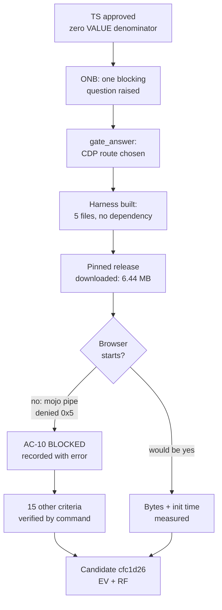

# RF — OOP_20261007-230107_TFS: Verify the TFW Full setup with measured evidence

> **Current filename**: `RF__OOP_20261007-230107_TFS.md`; later rounds append to this file.
> **Date**: 2026-10-07
> **Author**: Executor (dsh:session:local:weboop-init-20261007)
> **Status**: 🟢 RF — Complete
> **Parent HL**: [HL-OOP_20261007-230107_TFS.md](HL-OOP_20261007-230107_TFS.md)
> **TS**: [TS__OOP_20261007-230107_TFS.md](TS__OOP_20261007-230107_TFS.md)
> **Producer unit**: `dsh:session:local:weboop-init-20261007`
> **Parent Coordinator**: `dsh:session:local:weboop-init-20261007`
> **Activation / dispatch source**: owner-direct (owner `zhassulan`, approved TS 2026-10-07)
> **Coordination authority**: `HL-OOP_20261007-230107_TFS.md @ 3f5eff6f5e87f4afcc401f29aab8c5b4dfd83426`
> **Originating proposer**: none (owner-direct — no agent principal or delegation)
> **Current selection**: `reporting: native-gates`, `selection_ref: baseline` (verified baseline of the initial owner choice under the frozen authority above)
> **Launch observation**: requested model unknown to this Executor (no model or effort setting was observable from inside the runtime); delivery complete; material rework: one round, caused by the failed `.tar.gz` download and the nested-archive path defect, both fixed before the Candidate

---

## 1. What Was Done

Verified the project's configured state with commands and recorded the observed output for every
acceptance criterion that does not need a browser, and built a measurement harness for the one that
does. **The runtime measurement could not be taken**: the DSH sandbox denies the named-pipe creation
Chromium requires, so Chrome 154 and Edge 154 both abort before starting. That is recorded as
`BLOCKED` with the fatal error, and no number from documentation was substituted for it.

### Actual Value-Bearing Accounting

| Fact | Actual result |
|---|---|
| TS approval ref | `5c155965b51e2518c7b0460a7fc2cfb8633a1c56` |
| Baseline / Candidate | `3f5eff6f5e87f4afcc401f29aab8c5b4dfd83426` / `cfc1d26b73c64ae2e160672f7f849a658b6f3855` |
| VALUE membership | **Empty.** The approved TS declared a zero-VALUE selector; no product code was created or modified, so no path is a VALUE member |
| Arithmetic | 0 additions + 0 deletions = 0 touched text LOC over the VALUE selector; 0 logical VALUE files; binary/non-text VALUE files N/A |
| Membership deviations | None. The seven ASSURANCE/TRACE outputs listed below are outside the VALUE selector by the TS's own classification, not by reclassification |
| Trigger disposition | No trigger reached: 5 files created and 1 modified in `tools/`, plus task artifacts; the configured prompts are 50 files and 5000 LOC |
| Authority and timing | Immutable denominator 0 VALUE files / 0 touched VALUE LOC, fixed at TS approval `5c15596`; multiplier not applicable at zero; no pre-work escalation required |
| Reproduction | Approved NUL-safe method unchanged: `git diff --name-status --find-renames=50% -z 3f5eff6 <CANDIDATE> -- $valuePaths` and `git diff --numstat` over the same empty selector |

### New Files

| File | Description |
|---|---|
| `tools/measure-pyodide/README.md` | Reproduction steps, the three facts every number must carry, and the harness's honest limits |
| `tools/measure-pyodide/fetch_core.py` | Downloads and unpacks the pinned `pyodide-core` 314.0.7 release; standard library only; reports unpacked sizes |
| `tools/measure-pyodide/index.html` | Measurement page: loads the runtime, times load and init separately, runs the OOP probe, publishes one JSON object |
| `tools/measure-pyodide/measure.mjs` | Drives Chrome or Edge over CDP through Node's built-in `WebSocket`; no external dependency |
| `tools/measure-pyodide/oop_probe.py` | Standard-library-only probe covering the three declared weeks: encapsulation, inheritance and composition, polymorphism and abstractions |
| `workspace/…/economics/roles/executor__capture-failure.jsonl` | Typed capture-failure receipt for this Executor's economics contribution |

### Modified Files

| File | Changes |
|---|---|
| `workspace/…/evidence/EV__OOP_20261007-230107_TFS.md` | Round-1 rows E2–E18 and `E-accounting` appended; the pre-TS row E1 preserved unchanged |
| `.gitignore` | Excludes the downloaded runtime and the generated measurement report; neither is source |

## 2. Key Decisions

1. **The measurement route was answered through `gate_answer`, not by guessing.** The Executor raised
   the question as blocking and the owner answered it; the ONB was not edited by another role.
2. **CDP over Node's built-in `WebSocket`, with no package installed.** The first suggestion was a
   puppeteer-style library, but `npm` does not resolve as a command in this environment, so that route
   could not have been installed. Using the protocol directly removed the dependency and kept the
   approved file set unchanged.
3. **A blocked measurement is reported as blocked.** The TS's Definition of Failure forbids presenting
   a documentation number as measured. The roadmap's `6.4 MB` was found to match the compressed core
   archive, which makes it tempting to adopt — and it is still not reported as a measurement.
4. **The downloaded runtime was excluded from the repository.** It is reproducible from a pinned
   release; committing 6.44 MB of vendor payload would be needless weight in the product's history.
5. **Two harness defects were found and fixed before the Candidate**, not papered over: the published
   asset is `.tar.bz2` while the upstream page describes `.tar.gz`, and the archive nests everything
   under `pyodide/`, which would have broken every URL in the page.

## 3. Acceptance Criteria

- [x] AC-1 config and version verified — E2
- [x] AC-2 owner profile verified — E3
- [x] AC-3 Project North Star verified — E4
- [x] AC-4 knowledge entry verified — E5
- [x] AC-5 `AGENTS.md` managed block verified — E6
- [~] AC-6 adapter commands resolve (verified, E7); the `micropip` question from a real run (**blocked**, E8)
- [x] AC-7 build commands are real — E9, with the `npm` resolution defect recorded as E14
- [x] AC-8 task control files verified — E10
- [x] AC-9 measurement harness stays out of the product — E13
- [ ] AC-10 Pyodide cost measured — **BLOCKED**, E11; static asset sizes measured separately as E12
- [x] AC-11 framework core untouched — E15
- [x] AC-12 language and content contract hold — E16
- [x] AC-13 evidence and RF delivered — E17

**Baseline obligations preserved.** The seven-field routing spine and `coordination_authority` were
not rewritten; HL and TS were not modified (Executor Role Lock); `.tfw/` is byte-identical to the
baseline (E15); independent review is neither written nor pre-empted by this artifact. No obligation
was relocated or superseded, so no HL amendment is claimed.

## 4. Verification

- Lint (`npm run lint`): **not run.** `npm` does not resolve as a command in this shell, and the stack
  is not chosen, so there is no lint configuration to run against. Recorded as E9 and E14, not claimed
  as passing.
- Tests (`npm run build && npm test`): **not run**, for the same reason.
- Checks that were run: `git diff`/`git log`/`ls-files` inspection, `Select-String` over the config,
  the profile, the README, `KNOWLEDGE.md`, `AGENTS.md` and `status.md`; resolution of all 11 adapter
  workflow citations; `python fetch_core.py`; `python .tfw/economics/tfw_economics.py validate` on the
  failure receipt; two browser launches, both fatal.

## 5. Evidence

See [EV file](evidence/EV__OOP_20261007-230107_TFS.md) for evidence details.

Evidence verdict: 15/18 VERIFIED, 0 DEFERRED, 3 BLOCKED, 0 N/A

**Task-owned resources and disposition.**

| Resource | Ownership | Current / expected disposition |
|---|---|---|
| `tools/measure-pyodide/vendor/` (6.44 MB archive + 14.4 MiB unpacked) | Executor, git-ignored | **Retained** deliberately: the harness cannot run without it, and the owner may run the blocked measurement outside the sandbox. Reproducible by `python fetch_core.py`; safe to delete |
| `tools/measure-pyodide/measurement-report.json` | Executor, git-ignored | Generated by `measure.mjs`; currently records only the two launch failures. Overwritten on the next run |
| `tools/measure-pyodide/` tracked sources | Project | **Retained**: they are the reproduction method named by TS AC-10 and reviewed as deliverable ASSURANCE |
| Local static server on port 8801 | Executor | **Stopped** |
| Chrome and Edge probe profiles under the system temp directory | Executor | **Removed**; each probe used a fresh temporary profile |
| `economics/roles/executor__capture-failure.jsonl` | Executor | **Retained** as the task's economics TRACE, SHA-256 `d131607d5fcfecf53349e5f03f92526fbfc269424175b47362ba15c5ce93d1ac` |

No worktree, branch or helper process remains. The Coordinator owns final cleanup after review and
capture; nothing here requires it before that.

## 6. Observations (out-of-scope, not modified)

| # | File | Line(s) | Type | Description |
|---|---|---|---|---|
| 1 | `.tfw/economics/tfw_economics.py` | provider enum | naming | The helper admits only `codex.rollout`, `claude.code-jsonl` and `antigravity.ide` as sources, so a DSH contribution must record a `source_namespace` that does not describe its real origin. The true source is preserved in `source_label` and in the failure `detail`, but the namespaced field is misleading. Out of scope: `.tfw/` may only change through `/tfw-update` |
| 2 | `tools/measure-pyodide/measure.mjs` | `--no-sandbox` absence | security | The script launches a browser without `--no-sandbox`. Under this sandbox that is irrelevant, since the process cannot start either way; on an unrestricted machine the default flag set is the safer choice and needs no change |
| 3 | `.tfw/project_config.yaml` | `build.lint`, `build.test` | missing-config | The commands are real but not yet executable because the stack is unset. They will stay unverifiable until a product task chooses a stack, which is exactly what HL §8 records |

## 7. Fact Candidates

| # | Category | Candidate | Source | Confidence |
|---|---|---|---|---|
| 1 | Ограничение среды | DSH не отдаёт агенту счётчики токенов, времени или стоимости, поэтому экономический вклад задачи не измеряется | Executor, при попытке собрать вклад 2026-10-07 | High |
| 2 | Ограничение среды | Песочница DSH запрещает создание именованных каналов, из-за чего Chromium-браузеры не запускаются вообще | Executor, две неудачные попытки запуска Chrome и Edge | High |
| 3 | Достоверность источника | Страница документации Pyodide описывает `pyodide-core` как `.tar.gz`, но такого ассета не существует: публикуется `.tar.bz2` | Executor, запрос к GitHub releases API | High |
| 4 | Продуктовое решение | Владелец выбрал автоматический замер через CDP, отказавшись от ручного | Owner, ответ на `gate_answer` 2026-10-07 | High |

## 8. Strategic Insights (Execution)

| # | Insight | Category | Source |
|---|---|---|---|
| S1 | Владелец предпочёл потратить инструментальную работу на воспроизводимое измерение вместо быстрого ручного числа — приоритет доказательности над скоростью, что согласуется с его прежним выбором оставить H1 непроверенной | Приоритеты | User, ответ на `gate_answer` 2026-10-07 |
| S2 | Владелец принял ответ «измерение заблокировано средой» без попытки подставить число из документации — тот же принцип, что и в §7.8 HL, теперь подтверждённый на практике исполнения | Готовность к неопределённости | User, реакция на отчёт о блокере |

## 9. Diagrams

### Material handover at this return

- **Producer/unit:** Executor, `dsh:session:local:weboop-init-20261007`.
- **Source/epoch:** baseline `3f5eff6f5e87f4afcc401f29aab8c5b4dfd83426`; TS approval
  `5c155965b51e2518c7b0460a7fc2cfb8633a1c56`; Candidate `cfc1d26b73c64ae2e160672f7f849a658b6f3855`.
- **Inspected scope:** task status and journal, HL, TS, `.tfw/project_config.yaml`, `team/`, `README.md`,
  `KNOWLEDGE.md`, `AGENTS.md`, `.agents/skills/`, the EV file, the Pyodide releases API and
  documentation, and the local runtime and browser environments.
- **Material:** the runtime cost of Pyodide remains unmeasured and the reason is environmental, not
  documentary; the upstream documentation's asset extension is wrong; the economics contract cannot
  represent a DSH source honestly.
- **Uncertainty:** the three blocked measurements; whether the OOP probe passes inside Pyodide
  (static imports suggest yes, execution is unproven); whether `npm` resolves under the owner's normal
  shell, which would change the AC-7 assessment.
- **Continuation:** `/tfw-review` — independent Reviewer checks this RF against the approved TS and the
  evidence. This Executor does not write REVIEW and stops here.
- **Unresolved owner/decision:** whether to obtain the blocked measurement by running `node measure.mjs`
  outside the sandbox, or by granting broader sandbox access for one retry. The product stack remains
  unchosen and outside this task.

---

*RF — OOP_20261007-230107_TFS: Verify the TFW Full setup with measured evidence | 2026-10-07*
