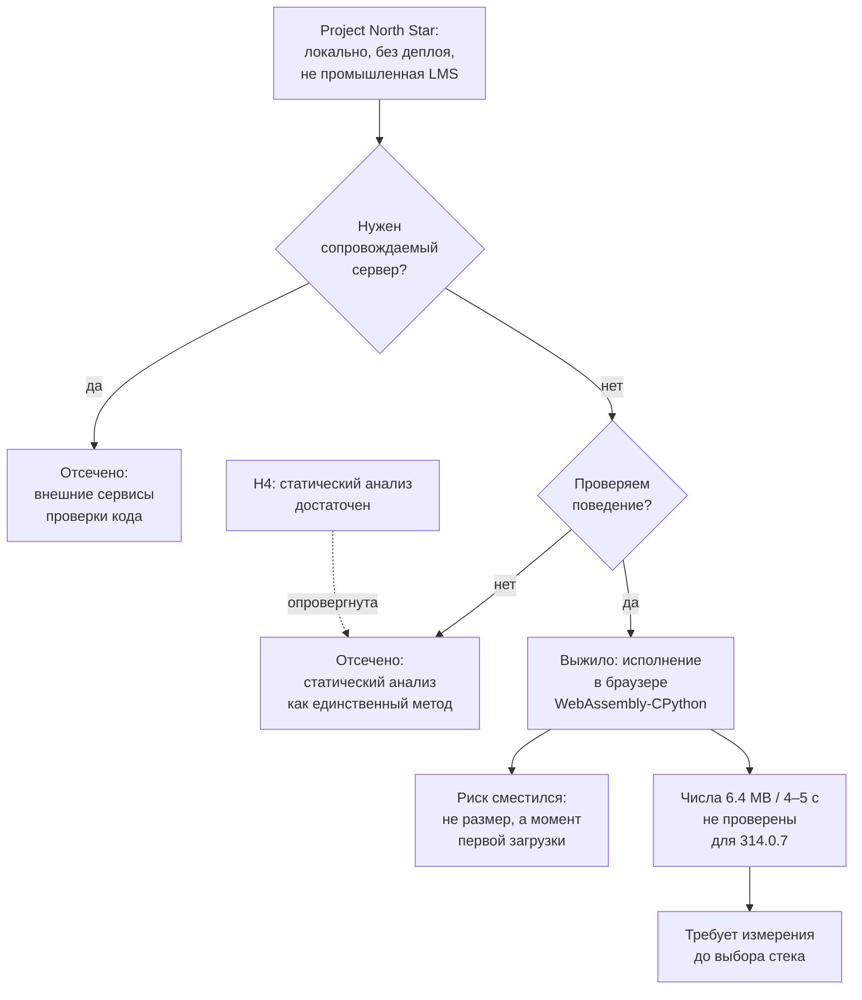

# RES — OOP_20261007-230107_TFS: Локальная проверка кода студентов

> **Current filename**: fixed `research/iter1/RES.md` under the selected task.
> **Date**: 2026-10-07
> **Author**: Researcher (dsh:session:local:weboop-init-20261007)
> **Status**: 🔬 RES — In progress
> **Parent HL**: [HL-OOP_20261007-230107_TFS.md](../HL-OOP_20261007-230107_TFS.md)
> **Mode**: Pipeline
> **Producer unit**: `dsh:session:local:weboop-init-20261007`
> **Parent Coordinator**: `dsh:session:local:weboop-init-20261007`
> **Activation / dispatch source**: owner-direct (owner `zhassulan`)
> **Coordination authority**: `HL-OOP_20261007-230107_TFS.md @ ce22916c9f5fd5e52f7f81021943cfd2ff3b32fc`
> **Originating proposer**: none (owner-direct — no agent principal or delegation)

---

## Research Context

Задача — настроить проект WEBOOP на TFW Full. Инициализация уже выполнена; исследование нужно,
чтобы продуктовая задача про курс по ООП получила проверенный вход, а не набор догадок. Итерация 1
отвечала на узкий вопрос: как проверять код студентов автоматически, если сайт запускается
**локально, без деплоя**, а Project North Star прямо запрещает превращать проект в промышленную LMS
с облачным деплоем. Владелец дополнительно потребовал, чтобы проверялось **поведение** кода, а не
только его структура.

## Briefing

Полный брифинг: [1_briefing.md](1_briefing.md). Ключевые решения владельца, принятые по ходу
исследования и записанные там же: язык — Python; цена WebAssembly-рантайма — приемлема после
получения чисел; проверка поведения обязательна; автопроверка охватывает ДЗ и экзамен (не каждую
практику); основное направление — исполнение в браузере (C1).

## Decisions

| # | Decision | Rationale |
|---|----------|-----------|
| D1 | Проверка поведения кода обязательна, проверка только структуры или синтаксиса недостаточна | Требование владельца; иначе студент может объявить класс и метод, которые не работают, и проверка это пропустит (Extract E1) |
| D2 | Исполнение кода студента происходит **в браузере** через WebAssembly-CPython (Pyodide), а не на сервере | Единственная конфигурация, одновременно дающая проверку поведения и не требующая сопровождаемого сервера; P0 отсекает всё серверное (Extract E2, Challenge) |
| D3 | Автопроверка охватывает домашние задания и экзамен, а не каждую практику | Решение владельца; сокращает объём проверочной инфраструктуры без потери обратной связи (Extract, комбинация вне брифинга) |
| D4 | Раздавать `pyodide-core`, а не полную раздачу, и отдавать файлы статически | Полная раздача — 200+ MB против минимального набора для запуска; статическая раздача не требует сервера разработчика (Gather G2) |
| D5 | Статический анализ сохраняется как дополнительный слой, но не как замена исполнению | Challenge C5: H4 опровергнута как достаточная альтернатива, но остаётся полезной как дополнение |
| D6 | Фактический размер и время первой загрузки измеряются до выбора стека | Challenge C1: числа из roadmap принадлежат старой версии документации и не проверены для 314.0.7 |

## Open Questions

| # | Question | Status | Answer |
|---|----------|--------|--------|
| Q1 | Каков фактический размер первой загрузки `pyodide-core` 314.0.7? | open | Из документации не выводится; требует измерения на реальной сборке |
| Q2 | Нужен ли `micropip` для учебных примеров ООП? | open | Предположительно нет — достаточно `python_stdlib.zip`, но не проверено |
| Q3 | Какая стратегия предзагрузки рантайма убирает ожидание в момент первого задания? | open | Кандидат: фоновая загрузка при открытии задания (Challenge C4) |

## Hypotheses (from HL §10)

| # | Hypothesis | HL Status | RES Status | Evidence |
|---|-----------|-----------|------------|----------|
| H2 | Автоматическая проверка кода студентов достижима локально без серверного исполнения кода | open | ✅ **supported** | Challenge: C1 выжила единственной; статическая раздача `pyodide-core` не требует сервера; внешний сервис отсечён P0 |
| H3 | Существующая песочница (например, Pyodide) снимает необходимость писать собственный исполнитель | open | ✅ **supported** | Gather G2 + Challenge C3: Pyodide — это CPython 3.14.2, собранный в WASM; писать собственный исполнитель не требуется |
| H4 | Статический анализ + тесты дают студенту достаточную обратную связь без запуска произвольного кода | open | ❌ **refuted** | Challenge C5: требование владельца проверять поведение делает исполнение обязательным; статический анализ не может проверить поведение |
| H1 | Три недели достаточны для целостного вводного курса по ООП | open | ⬜ deferred | Отнесена к `iter2` решением `research/iterations.yaml` |
| H5 | Балльная система без аутентификации достаточна и не противоречит P0 | open | ⬜ deferred | Отнесена к `iter2` решением `research/iterations.yaml` |

## HL Update Recommendations

> Researcher классифицирует, но не применяет и не выносит решений.

### Refinements — free sections, coordinator applies

| # | § | What to update | Source |
|---|---|----------------|--------|
| R1 | §2 Current State | Добавить, что механика проверки кода определена: исполнение в браузере через WebAssembly-CPython, автопроверка в ДЗ и на экзамене; выбор стека по-прежнему открыт | RES D2, D3 |
| R2 | §9 Risks (R4) | Уточнить R4: команды `npm run build && npm test` станут проверяемыми после выбора стека, но сам механизм проверки кода уже определён и от стека не зависит | RES D2 |
| R3 | §9 Risks | **Перевести в факт**: числа 6.4 MB и 4–5 с из roadmap Pyodide принадлежат версии документации 0.19.1 и не проверены для 314.0.7; фактическая цена неизвестна и требует измерения (новый риск или уточнение R4) | Challenge C1 |
| R4 | §9 Risks (R7) | Понизить вероятность R7: Pyodide 314.0.7 — это CPython 3.14.2 в WASM, поэтому курс не требует от автора умения собирать интерпретатор; остаточный риск — организация проверок, а не их исполнение | Challenge C3 |
| R5 | §10 Hypotheses | Обновить статусы: H2 ✅ supported, H3 ✅ supported, H4 ❌ refuted владельческим требованием проверять поведение; H1 и H5 остаются open до `iter2` | RES Hypotheses |
| R6 | §10 Blind Spots | Заменить пункт «не определена модель автопроверки» на фактическое состояние: модель определена (браузер, WebAssembly), неизвестна её измеренная цена | RES D2, Challenge C1 |

### Amendment Proposals — frozen sections, resolved-ruler verdict required

| # | § | Type | Proposed change | Evidence | Cost | Alternatives considered |
|---|---|------|-----------------|----------|------|------------------------|
| A1 | §3 | `RESTRICT` | Зафиксировать в To-Be, что автопроверка охватывает домашние задания и экзамен, но не каждую практику — тем самым **сужая** объём проверочной инфраструктуры | Решение владельца 2026-10-07 после стадии Extract; комбинация, не предложенная в первоначальном брифинге | Отсутствует: сужение объёма уменьшает работу | Проверка на каждой практике (больше работы и больше пользы); проверка только на экзамене (минимум работы, но студент без обратной связи по ходу курса) |

## Fact Candidates

| # | Category | Candidate | Source | Confidence |
|---|----------|-----------|--------|------------|
| F1 | Ограничение среды | Полная раздача Pyodide превышает 200 MB, тогда как `pyodide-core` предназначен для минимального запуска; в проекте следует использовать вторую | Gather G2, [Downloading and deploying Pyodide](https://pyodide.org/en/stable/usage/downloading-and-deploying.html) | ★★★ |
| F2 | Техническое ограничение | В Pyodide отсутствуют сокеты, поэтому `requests` и подобные пакеты неприменимы; ограничение снято дорожной картой как отдельная задача | Gather G3, [Roadmap](https://pyodide.org/en/stable/project/roadmap.html) | ★★★ |
| F3 | Проектное решение | Проверка поведения кода признана обязательной, а проверка только структуры или синтаксиса — недостаточной | Владелец `zhassulan`, 2026-10-07, после стадии Gather | ★★★ |
| F4 | Проектное решение | Автопроверка охватывает ДЗ и экзамен, но не каждую практику | Владелец `zhassulan`, 2026-10-07, после стадии Extract | ★★★ |
| F5 | Достоверность источника | Числа 6.4 MB и 4–5 с получены из roadmap версии документации 0.19.1 и не подтверждены для релиза 314.0.7 | Challenge C1, сверка Gather G1 с changelog | ★★★ |

## Strategic Insights (Research)

| # | Category | Insight | Source | Confidence |
|---|----------|---------|--------|------------|
| SS1 | Ограничение объёма | Владелец сознательно снизил частоту автопроверки (ДЗ и экзамен вместо каждой практики), выбрав меньший объём работы при сохранении обратной связи — это сигнал, что бюджет времени для него важнее полноты покрытия | User, решение после Extract | ★★★ |
| SS2 | Критерий выбора | Для владельца «работает локально, без деплоя» означает **отсутствие сопровождаемого сервера**, а не отсутствие интернета: он ослабил офлайн-требование, но не ослабил запрет на серверную часть | User, ответы на брифинг + Extract E2 | ★★★ |
| SS3 | Готовность к цене | Владелец не отверг тяжёлый рантайм заранее, а запросил конкретные числа перед решением — предпочитает решение по данным, а не по общим соображениям | User, отложенное решение на брифинге | ★★☆ |

## Findings Map

## Iteration Status

- **Iteration:** 1 of 2 (min) / 5 (max)
- **Hypotheses tested:** H2 (supported), H3 (supported), H4 (refuted)
- **Hypotheses deferred:** H1 (отнесена к `iter2`), H5 (отнесена к `iter2`) — обе решением `research/iterations.yaml`
- **Gaps discovered:** фактическая цена первой загрузки `pyodide-core` 314.0.7 не установлена; необходимость `micropip` для учебных примеров не проверена; стратегия предзагрузки рантайма не выбрана
- **Superseded decisions:** none

### Open Threads (for next iteration)

| # | Thread | Why it matters | Suggested focus |
|---|--------|---------------|-----------------|
| 1 | Реалистичность трёх недель по одному часу лекций и практики (H1) | Если объём не укладывается, структура курса изменится, и это повлияет на проект продукта сильнее, чем механика проверки | `iter2`: сверить темы «инкапсуляция → наследование → полиморфизм» с общепринятыми вводными курсами и их нагрузкой |
| 2 | Балльная система без аутентификации (H5) | Если баллы требуют учёта пользователей, появляется хранение данных, что задевает P0 | `iter2`: проверить, достаточно ли локального хранения прогресса без учётных записей |
| 3 | Измерение цены загрузки | Решение о стеке будет приниматься без ключевого числа, если его не измерить | Продуктовая задача: измерить на реальной сборке до выбора стека (не решается чтением документации) |

### Recommendation

- [ ] **SUFFICIENT** — proceed to `/tfw-plan`
- [x] **MORE NEEDED** — `iter2` обязательна: `tfw.research.min_iterations` = 2 является hard-лимитом, и HL DoD 12 требует ответа на H1–H5, из которых H1 и H5 не проверены
- [ ] **BLOCKED**

## Conclusion

Итерация 1 превратила открытый вопрос «как проверять код студентов» в одно выжившее решение.
Сведение измерений показало, что «отсутствие сопровождаемого сервера» — не одно из требований, а
критерий, который делит всё пространство надвое, а требование владельца проверять поведение
отсекает оставшуюся половину: выживает исполнение Python в браузере через WebAssembly. Попутно
опровергнута H4 (статический анализ как достаточный метод) и подтверждены H2 и H3.

Главная ценность этой итерации — не выбранный вариант, а **обнаруженная недостоверность
собственных исходных данных**: числа 6.4 MB и 4–5 секунд, на которых владелец принимал решение о
приемлемости цены, взяты из roadmap версии документации 0.19.1 и не подтверждены для релиза
314.0.7. Без этой проверки проект вошёл бы в планирование с числом, за которое никто не отвечает.
Саморефлексия: `focused` с одним проходом на стадию оказался достаточно — но лишь потому, что
владелец ответил на уточняющие вопросы. Без этих ответов Extract не смог бы отсечь ветки, и режим
`deep` с обязательным counter-evidence был бы уместнее.

### Material handover at this return

- **Producer/unit:** Researcher, `dsh:session:local:weboop-init-20261007`.
- **Inspected scope:** `1_briefing.md`, `2_gather.md`, `3_extract.md`, `4_challenge.md`;
  внешние источники — roadmap Pyodide, документация по развёртыванию, changelog 314.0.7,
  документация StackBlitz WebContainers, публикация IEEE о статической оценке, материалы Judge0;
  Project North Star (`README.md`).
- **Material:** механика проверки кода определена (браузер, WASM); H4 опровергнута; цена загрузки
  неизвестна и требует измерения; `focused` оказался достаточен только благодаря ответам владельца.
- **Uncertainty:** фактический размер и время первой загрузки; необходимость `micropip`; стратегия
  предзагрузки.
- **Continuation:** `iter2` по H1 и H5, затем синтез и решение о достаточности исследования.
- **Unresolved owner/decision:** предложение A1 (§3 `RESTRICT`, охват автопроверки) ждёт вердикта
  владельца; refinements R1–R6 применяются Координатором без отдельного вердикта.

---

*RES — OOP_20261007-230107_TFS: Локальная проверка кода студентов | 2026-10-07*
