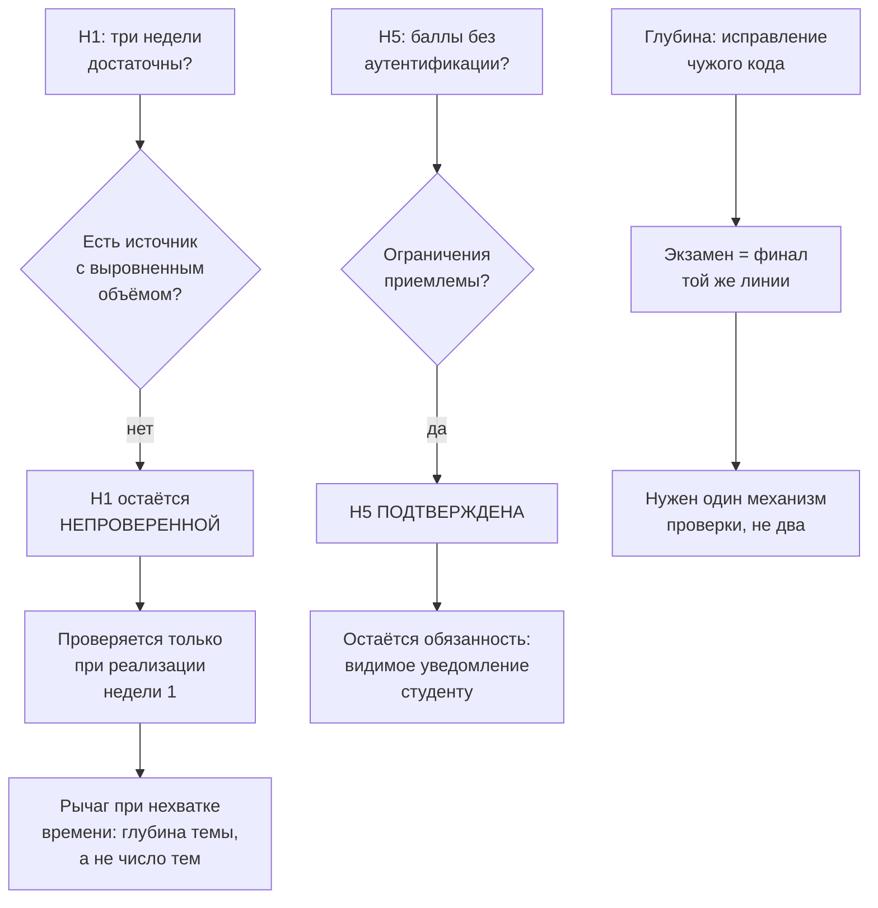

# RES — OOP_20261007-230107_TFS: Реалистичность объёма и модель баллов

> **Current filename**: fixed `research/iter2/RES.md` under the selected task.
> **Date**: 2026-10-07
> **Author**: Researcher (dsh:session:local:weboop-init-20261007)
> **Status**: 🔬 RES — In progress
> **Parent HL**: [HL-OOP_20261007-230107_TFS.md](../HL-OOP_20261007-230107_TFS.md)
> **Mode**: Pipeline
> **Producer unit**: `dsh:session:local:weboop-init-20261007`
> **Parent Coordinator**: `dsh:session:local:weboop-init-20261007`
> **Activation / dispatch source**: owner-direct (owner `zhassulan`)
> **Coordination authority**: `HL-OOP_20261007-230107_TFS.md @ ce22916c9f5fd5e52f7f81021943cfd2ff3b32fc`
> **Originating proposer**: none (owner-direct — no agent principal or delegation)

---

## Research Context

Итерация 2 закрывала два вопроса, отложенных из итерации 1: укладывается ли заявленный объём курса
(3 недели × 1 ч лекции × 1 ч практики × ~1 ч ДЗ) в целостный вводный курс по ООП, и достаточна ли
балльная модель без аутентификации в условиях P0, запрещающего серверную часть. Итерация 1 уже
определила механику проверки кода; здесь речь о **плотности курса** и **хранении результата**.

## Briefing

Полный брифинг: [1_briefing.md](1_briefing.md), включая оба уточнения, полученные по ходу стадий.
Ключевые решения владельца: час ДЗ — жёсткое ограничение; потеря прогресса допустима; сумма баллов
сохраняется между сессиями, но не является документом; глубина тем — разбор и исправление чужого
кода; три темы сохраняются; обратная связь один раз в конце недели.

**Предшественник:** [iter1/RES.md](../iter1/RES.md) — механика проверки кода и недостоверность
чисел загрузки.

## Decisions

| # | Decision | Rationale |
|---|----------|-----------|
| D7 | Курс сохраняет три темы: инкапсуляция → наследование → полиморфизм | Extract E5: сокращение до двух тем не экономит час студента, но разрывает целостную линию — полиморфизм опирается на наследование |
| D8 | Глубина темы — разбор и исправление чужого кода, а не написание программы с нуля | Extract E2: при жёстком часе ошибка в проектировании съедает весь час; исправление ограничивает пространство поиска. Цена — меньше самостоятельного проектирования (Challenge C4) |
| D9 | Экзамен — не отдельный формат, а финал той же линии | Extract E3: Project North Star уже определяет экзамен как поиск и исправление ошибок; курс и экзамен тренируют один навык, значит нужен один механизм проверки |
| D10 | Обратная связь автоматической проверки — один раз в конце недели | Решение владельца; вес переносится на разбор в занятии (Challenge C5) |
| D11 | Баллы хранятся в браузере, накапливаются между сессиями, не защищены от изменения и не являются документом | Решения владельца; снимает потребность в подписи, защите и серверной сверке (Extract E4) |
| D12 | Объём курса остаётся **гипотезой, проверяемой в процессе**, а не принятым решением | Challenge C1/C2: выровненного свидетельства нет, H1 не подтверждена; понедельная сборка делает риск управляемым |
| D13 | Баллы и прогресс должны сопровождаться видимым уведомлением о привязке к браузеру | Challenge C3: владелец принял потерю данных, но студент обязан понимать ограничение, иначе он обоснованно считает сумму своим результатом |

## Open Questions

| # | Question | Status | Answer |
|---|----------|--------|--------|
| Q4 | Сколько фактически времени занимает неделя 1 у реального студента? | open | Только измерение при реализации; это первое настоящее свидетельство по H1 |
| Q5 | Как формулируется уведомление о привязке баллов к браузеру? | open | Решение интерфейса, вынесено требованием D13 |
| Q6 | Что происходит, если разбор в занятии не состоится? | open | Challenge C5: студент остаётся без обратной связи до конца недели; риск продукта |

## Hypotheses (from HL §10)

| # | Hypothesis | HL Status | RES Status | Evidence |
|---|-----------|-----------|------------|----------|
| H1 | Три недели достаточны для целостного вводного курса по ООП при ограничении темами инкапсуляции, наследования и полиморфизма | open | ⬜ **not verified** | Challenge C1: все найденные источники описывают семестровые курсы с несопоставимым объёмом; выровненного свидетельства нет, подгонка отвергнута |
| H5 | Балльная система без аутентификации достаточна и не противоречит P0 | open | ✅ **supported** | Gather G2 (практика клиентского хранения), G3 (ограничения названы), решения владельца их закрывают; остаётся обязанность D13 |
| H2 | Автоматическая проверка кода достижима локально без сервера | open | ✅ supported | iter1 RES |
| H3 | Существующая песочница снимает необходимость писать свой исполнитель | open | ✅ supported | iter1 RES |
| H4 | Статического анализа достаточно без запуска кода | open | ❌ refuted | iter1 RES |

## HL Update Recommendations

### Refinements — free sections, coordinator applies

| # | § | What to update | Source |
|---|---|----------------|--------|
| R7 | §2 Current State | Добавить, что объём курса (3 недели) остаётся **непроверенной гипотезой**: выровненного свидетельства нет, проверка возможна только при реализации недели 1 | Challenge C1, C2 |
| R8 | §9 Risks (R7) | Уточнить R7: курс сознательно тренирует чтение и коррекцию кода, а не проектирование с нуля; остаточный риск — потеря навыка проектирования, принята как ограничение курса | Challenge C4 |
| R9 | §9 Risks | Добавить риск: если разбор в занятии не состоится, студент остаётся без обратной связи до конца недели (автопроверка стоит в конце недели) | Challenge C5 |
| R10 | §9 Risks | Добавить риск: клиентское хранение баллов не защищено от изменения; принято сознательно, требует видимого уведомления студента | Extract E4, Challenge C3 |
| R11 | §10 Hypotheses | H5 → ✅ supported; H1 → остаётся open, но переформулировать как «проверяется при реализации недели 1», а не как ожидающее внешнего исследования | RES Hypotheses |
| R12 | §10 Blind Spots | Заменить пункты про модель баллов и объём: модель баллов определена (клиентская, без аутентификации), объём — непроверенная гипотеза с известным рычагом (глубина темы) | RES D11, D12 |

### Amendment Proposals — frozen sections, resolved-ruler verdict required

| # | § | Type | Proposed change | Evidence | Cost | Alternatives considered |
|---|---|------|-----------------|----------|------|------------------------|
| A2 | §3 | `EXTEND` | Зафиксировать в To-Be глубину курса: студент разбирает и исправляет готовый код, экзамен — финал той же линии, а не отдельный формат | Extract E2, E3; решение владельца 2026-10-07 | Отсутствует: уточняет уже заявленный формат экзамена | Написание программы с нуля (устойчивость хуже при жёстком часе); только чтение кода без исправления (не тренирует навык экзамена) |
| A3 | §3 | `EXTEND` | Зафиксировать модель баллов: клиентское хранение, накопление между сессиями, не документ, с обязательным видимым уведомлением студента о привязке к браузеру | Extract E4, Challenge C3; решения владельца 2026-10-07 | Небольшая работа по интерфейсу (уведомление) | Серверное хранение с учётными записями (запрещено P0); защита суммы от подделки (выходит за P0 и не нужна для недокумента) |

> **Предложение A1** (охват автопроверки: ДЗ и экзамен, не каждая практика) утверждено владельцем
> и внесено в §12 HL ранее; повторно не предлагается.

## Fact Candidates

| # | Category | Candidate | Source | Confidence |
|---|----------|-----------|--------|------------|
| F6 | Ограничение объёма | Час домашней работы признан жёстким ограничением: при нехватке времени сокращается тема, а не время | Владелец `zhassulan`, 2026-10-07 | ★★★ |
| F7 | Продуктовое решение | Глубина курса — разбор и исправление готового кода; студент не пишет программу с нуля | Владелец `zhassulan`, 2026-10-07 | ★★★ |
| F8 | Продуктовое решение | Баллы хранятся клиентски и не являются документом; потеря при очистке хранилища принята сознательно | Владелец `zhassulan`, 2026-10-07 | ★★★ |
| F9 | Продуктовое решение | Сумма баллов должна сохраняться между сессиями, но не обязана переживать очистку хранилища | Владелец `zhassulan`, 2026-10-07 | ★★★ |
| F10 | Достоверность данных | Объём «три недели» не подтверждён ни одним сопоставимым источником; найденные курсы семестровые | Challenge C1, Gather G1 | ★★★ |

## Strategic Insights (Research)

| # | Category | Insight | Source | Confidence |
|---|----------|---------|--------|------------|
| SS4 | Критерий выбора | Владелец выбирает устойчивость при жёстком часе (исправление чужого кода) вместо максимальной самостоятельности студента — приоритет отдан тому, чтобы студент доходил до результата, а не тому, чтобы он проектировал сам | User, решение после Gather | ★★★ |
| SS5 | Приоритеты | Владелец отверг защиту баллов от подделки, согласившись, что сумма — обратная связь, а не отчёт. Это удерживает проект в границах «локально, без сервера» даже ценой отсутствия доверенного результата | User, решение после Gather | ★★★ |
| SS6 | Готовность к неопределённости | Владелец предпочёл оставить H1 непроверенной, а не подтверждать её слабыми данными — готов принимать явную неизвестность вместо ложной определённости | User, решение после Extract | ★★★ |

## Findings Map

## Iteration Status

- **Iteration:** 2 of 2 (min) / 5 (max)
- **Hypotheses tested:** H1 (not verified — выровненного свидетельства нет), H5 (supported)
- **Hypotheses deferred:** None — все пять гипотез HL §10 получили статус
- **Gaps discovered:** фактическое время прохождения недели 1 (измеримо только при реализации); формулировка уведомления о привязке баллов; последствия несбывшегося разбора в занятии
- **Superseded decisions:** none

### Open Threads (for next iteration)

| # | Thread | Why it matters | Suggested focus |
|---|--------|---------------|-----------------|
| 1 | Фактическое время прохождения недели 1 | Единственный способ проверить H1; влияет на объём всех последующих недель | Не исследование, а измерение при реализации продуктовой задачи |
| 2 | Формулировка уведомления о привязке баллов к браузеру | Обязанность перед студентом, вытекающая из D13; без неё принятый риск потери данных становится нечестным | Решение интерфейса в продуктовой задаче |

### Recommendation

- [x] **SUFFICIENT** — `iter2` довела число завершённых итераций до `min_iterations: 2`; все пять
  гипотез HL §10 получили статус (H2, H3, H5 supported; H4 refuted; H1 not verified). Дальнейшее
  исследование не изменит выводов: единственный открытый вопрос по H1 требует измерения при
  реализации, а не чтения источников.
- [ ] **MORE NEEDED**
- [ ] **BLOCKED**

## Conclusion

Итерация 2 закрыла оставшиеся вопросы и дала результат, который полезнее ложного подтверждения:
**H1 не подтверждена**. Все найденные вводные курсы по программированию семестровые и покрывают
объём существенно больше заявленного, а источника, выровненного ровно по «инкапсуляция →
наследование → полиморфизм», не существует. Три способа закрыть гипотезу — по семестровым данным,
по анекдотическому опыту, рассуждением — отвергнуты как подгонка. Владелец заранее согласился
оставить H1 непроверенной, и это оказалось правильным решением: продуктовая задача получит объём
как **гипотезу, проверяемую на неделе 1**, а не как доказанное число, которое разрушилось бы на
третьей неделе.

Второй результат — подтверждение H5 с невыполненной обязанностью: клиентское хранение баллов
работоспособно, но студент обязан понимать, что сумма привязана к его браузеру. Без видимого
уведомления принятый риск потери данных перестаёт быть честным по отношению к студенту.

Третий результат структурный: выбранная глубина (исправление чужого кода) и формат экзамена
оказались **одной линией**, а не двумя решениями. Это сокращает объём продукта — нужен один
механизм проверки вместо двух — и одновременно накладывает ограничение: курс тренирует чтение и
коррекцию кода, а не проектирование с нуля. Ограничение надо назвать, а не замалчивать.

Саморефлексия: `focused` и здесь оказался достаточно, но обе стадии упирались в один и тот же
барьер — отсутствие сопоставимых источников. Режим `deep` с обязательным counter-evidence не спас
бы: проблема не в глубине поиска, а в том, что нужного класса источников не существует.

### Material handover at this return

- **Producer/unit:** Researcher, `dsh:session:local:weboop-init-20261007`.
- **Inspected scope:** `iter2/1_briefing.md`, `2_gather.md`, `3_extract.md`, `4_challenge.md`;
  `iter1/RES.md`; расписания вводных курсов CS (Fordham, Bilkent, CSC1001, CSAwesome); примеры
  клиентского хранения прогресса; Project North Star (`README.md`).
- **Material:** H1 не подтверждена и проверяется при реализации; H5 подтверждена с обязанностью
  уведомления; глубина курса и экзамен образуют одну линию; модель баллов определена.
- **Uncertainty:** фактическое время недели 1; формулировка уведомления; последствия несбывшегося
  разбора в занятии.
- **Continuation:** refinements R7–R12 к свободным разделам HL применяет Координатор; предложения
  A2 и A3 требуют вердикта владельца, так как §3 заморожен.
- **Unresolved owner/decision:** A2 (§3 `EXTEND`, глубина курса) и A3 (§3 `EXTEND`, модель баллов)
  ждут вердикта; A1 утверждён ранее.

---

*RES — OOP_20261007-230107_TFS: Реалистичность объёма и модель баллов | 2026-10-07*
