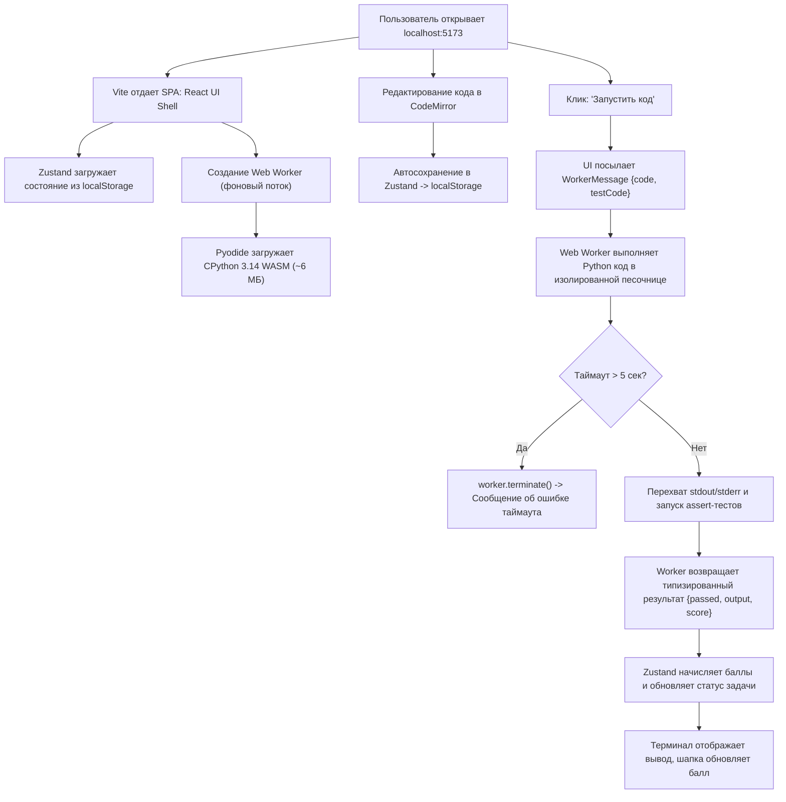

# HL — OOP_20261010-074918_LFRS: LMS Foundation and Runtime Skeleton

> **Current filename**: `HL-OOP_20261010-074918_LFRS.md`
> **Date**: 2026-10-10
> **Author**: Coordinator (Antigravity)
> **Title**: LMS Foundation and Runtime Skeleton
> **Abbreviation**: LFRS
> **Status**: 🔒 FROZEN — Approved by zhassulan 2026-10-10
> **Contract**: 🔒 FROZEN — approved by zhassulan 2026-10-10
> **Frozen**: §1 · §3 · §4 · §5 · §6 · §7 — locked on owner approval
> **Free**: §2 · §7.2 · §8 · §9 · §10 · §11 — research updates these directly
> **Append-only**: §12 Amendment Log — the only channel for changing a frozen section
> **Baseline**: freeze commits — recovery form in `conventions.md` §3 rule 15
> **Project North Star**: `README.md § Зачем этот проект` · `README.md § Что проект не должен делать` · `docs/ai-guidelines.md § 1. Миссия и границы продукта (North Star)`

---

## 1. Vision 🔒 FROZEN

В репозитории WEBOOP развернут и верифицирован целостный, компилируемый фундамент клиентской мини-LMS без реального учебного контента: реактивный UI-каркас со сплит-экраном (React 18/19, Vite, Tailwind CSS), изолированный Web Worker с рантаймом Python (Pyodide CPython 3.14 WASM), типизированное состояние с сохранением в `localStorage` (Zustand) и редактор кода (CodeMirror 6). Любой разработчик или студент запускает проект одной командой `npm run dev`, пишет код в браузере, исполняет его за секунду без зависания интерфейса и видит сохраненный прогресс.

**Impact:**
- **Для проекта:** Появляется рабочий фундамент, исключающий техническую неопределенность. Учебные материалы (Неделя 1, 2, 3 и Экзамен) будут внедряться в уже проверенную, компилируемую и работающую платформу отдельными изолированными задачами.
- **Для студента:** Мгновенный локальный старт без необходимости поднимать серверы, базы данных или настраивать локальный Python.
- **Для разработки:** Строгая система типов TypeScript (`src/types/course.ts`), автоматический линтинг и тесты гарантируют чистоту кодовой базы для всех последующих ИИ-агентов.

> *«Я запустил проект командой `npm run dev` без настройки Python и внешних баз данных. В браузере открылся двухпанельный интерфейс: редактор подсвечивает синтаксис, тестовый код выполняется прямо в браузере за пару секунд, а прогресс и набранный код сохраняются при обновлении страницы. Теперь в этот проверенный каркас можно безопасно заливать контент 1-й недели.»* — Воображаемый отзыв студента/методиста.

---

## 2. Current State (As-Is) 🟢 FREE

1. **Репозиторий:**
   - Содержит утвержденную системную документацию в [`docs/`](../../docs/) ([`docs/ai-guidelines.md`](../../docs/ai-guidelines.md), [`docs/stack.md`](../../docs/stack.md), [`docs/architecture/overview.md`](../../docs/architecture/overview.md), [`docs/domain/model.md`](../../docs/domain/model.md)).
   - Проектная инициализация TFW завершена в задаче `OOP_20261007-230107_TFS` (статус `DONE`).
   - Исходный код приложения (`package.json`, `src/`, `vite.config.ts`) отсутствует. Приложение невозможно запустить или скомпилировать.
2. **Проверенные факты окружения:**
   - [`KR-OOP-0001`](../../knowledge/records/KR-OOP-0001-pyodide-first-load-cost.md): Первый холодный запуск `pyodide-core` 314.0.7 требует скачивания 6.10 MiB (сжато) / 12.92 MiB (распаковано) и занимает ~1.84–2.34 с до состояния готовности рантайма.
   - [`KR-OOP-0002`](../../knowledge/records/KR-OOP-0002-runtime-environment-facts.md): Курсу не требуется `micropip` (только стандартная библиотека CPython 3.14); в среде DSH/песочницы браузерный запуск ограничен, поэтому сборка и тесты должны валидироваться через синтетические Vitest-тесты и браузерный смоук.
3. **Неизвестные и ограничения:**
   - Поведение CodeMirror 6 и Pyodide при сборке статики Vite (необходима корректная настройка Web Worker как отдельного чанка).
   - Сохранение реактивности при возврате результатов тестов из Web Worker в Zustand Store.

---

## 3. Target State (To-Be) 🔒 FROZEN

Репозиторий содержит полнофункциональный локальный клиентский скелет платформы:
1. Инфраструктура сборки: Vite + TypeScript (strict) + Tailwind CSS + ESLint + Vitest.
2. Слой доменных типов: `src/types/course.ts`, перенесенный из спецификации [`docs/domain/model.md`](../../docs/domain/model.md).
3. Слой исполнения (Execution Runtime): `src/workers/pyodide.worker.ts` с загрузкой Pyodide, выполнением скриптов, перехватом stdout/stderr и защитным 5-секундным таймаутом с возможностью перезапуска воркера.
4. Слой состояния (Store): `src/store/useCourseStore.ts` на Zustand с сохранением в `localStorage` и поддержкой импорта/экспорта в JSON.
5. Слой интерфейса (UI Shell): адаптивный SplitPane Layout, сайдбар навигации по курсу, CodeMirror 6 с подсветкой Python, панель терминала/вывода результатов тестов и бейдж баллов.
6. Демо-модуль (Smoke Content): 1 минимальный тестовый урок и 1 интерактивная задача ("Создать класс Counter с инкрементом") для сквозной проверки работоспособности без включения материалов Недели 1.

### 3.1 Result Visualization

#### Визуализация структуры репозитория (Before / After)

```
AS-IS (До задачи):                     TO-BE (После задачи):
WEBOOP/                                WEBOOP/
├── .tfw/                              ├── .tfw/
├── docs/                              ├── docs/
├── OOP/ (PDF-материалы)               ├── OOP/
├── README.md                          ├── package.json (Vite, React, Tailwind, CodeMirror, Zustand)
└── KNOWLEDGE.md                       ├── tsconfig.json (TypeScript strict)
                                       ├── vite.config.ts
                                       ├── tailwind.config.js
                                       ├── src/
                                       │   ├── types/course.ts (канонические интерфейсы)
                                       │   ├── workers/pyodide.worker.ts (WASM Python runner)
                                       │   ├── store/useCourseStore.ts (Zustand + localStorage)
                                       │   ├── components/
                                       │   │   ├── layout/AppLayout.tsx (Header + Sidebar + SplitPane)
                                       │   │   ├── editor/CodeEditor.tsx (CodeMirror 6 Python)
                                       │   │   ├── terminal/TerminalView.tsx (stdout & test runner UI)
                                       │   │   └── theory/TheoryView.tsx (Markdown-панель)
                                       │   ├── data/demoCourse.ts (тестовая заглушка без Недели 1)
                                       │   ├── App.tsx
                                       │   └── main.tsx
                                       └── tests/ (Unit-тесты стора и воркера)
```

#### Визуальный макет интерфейса в браузере (`localhost:5173`)

```
+--------------------------------------------------------------------------------------------------+
|  WEBOOP LMS  |  [ Демо-курс ООП ]                      [ Прогресс: 10 / 100 баллов ] [Экспорт JSON]|
+-------------------+----------------------------------------------+-------------------------------+
| САЙДБАР           | ЛЕВАЯ ПАНЕЛЬ: ТЕОРИЯ                         | ПРАВАЯ ПАНЕЛЬ: РЕДАКТОР И ВЫВОД|
|                   |                                              |                               |
| v Демо-модуль     | ## Демо-задача: Класс Counter                | # Код студента (CodeMirror 6) |
|   • Введение (10м)|                                              | class Counter:                |
|   * Практика (10б)| Создайте класс Counter со следующими         |     def __init__(self):       |
|                   | методами:                                    |         self.value = 0        |
| > Неделя 1 (скоро)| - `__init__(self)`: инициализирует 0         |     def inc(self):            |
| > Неделя 2 (скоро)| - `inc(self)`: увеличивает на 1              |         self.value += 1       |
| > Неделя 3 (скоро)| - `get_value(self)`: возвращает значение     |     def get_value(self):      |
| > Экзамен  (скоро)|                                              |         return self.value     |
|                   |                                              +-------------------------------+
|                   |                                              | [ > Запустить код ] [ Сдать ] |
|                   |                                              +-------------------------------+
|                   |                                              | ТЕРМИНАЛ ВЫВОДА:              |
|                   |                                              | [OK] Test 1: init counter = 0 |
|                   |                                              | [OK] Test 2: inc() counter = 1|
|                   |                                              | Все тесты пройдены! (+10 б.)  |
+-------------------+----------------------------------------------+-------------------------------+
```

### 3.2 Value Flow



---

## 4. Phases 🔒 FROZEN

Задача реализуется как единый целостный этап (Single-phase task) с 5 последовательными вехами (Milestones):

- **Milestone 1 (🔴 Tooling & Types):** Настройка `package.json`, Vite, TypeScript strict, Tailwind CSS, ESLint, перенос типов в `src/types/course.ts`.
- **Milestone 2 (🔴 Web Worker & Pyodide):** Реализация `src/workers/pyodide.worker.ts`, типизированный протокол обмена, перехват потоков, таймаут 5 секунд с перезапуском.
- **Milestone 3 (🟡 State & Persistence):** Хранилище Zustand с сохранением пользовательского кода, баллов и статусов задач в `localStorage`, функции экспорта/импорта.
- **Milestone 4 (🟡 UI Shell & CodeMirror):** SplitPane, Header с баллами, Sidebar с навигацией, CodeMirror 6 для Python, Terminal для вывода результатов.
- **Milestone 5 (🟢 Demo Task & Verification):** Демо-модуль с проверочным автотестом, прохождение `npm run lint`, `npm run typecheck`, `npm run build` и тестов.

### 4.1 Coordination Selection 🔒 FROZEN

| Activation source | Accountable owner | Task Coordinator unit | Phase Coordinator rule | Mandate scope / role reach | Upward route | Dialogue | Reporting | Reservations / controls | Amendment authority | Immutable epoch |
|---|---|---|---|---|---|---|---|---|---|---|
| owner-direct | zhassulan | `antigravity:coordinator:local:OOP_20261010-074918_LFRS` | none (single-phase task) | Task `OOP_20261010-074918_LFRS`: Coordinator, Executor, Reviewer | owner:zhassulan | tfw-gates-only | native-gates | Утверждение HL/TS, финальная приемка | none | baseline |

---

## 5. Definition of Done (DoD) 🔒 FROZEN

- ✅ 1. В корне репозитория настроен проект на Vite + React 18/19 + TypeScript (strict mode) + Tailwind CSS.
- ✅ 2. Команды `npm run typecheck`, `npm run lint` и `npm run build` отрабатывают с кодом 0 (без ошибок и предупреждений).
- ✅ 3. Интерфейсы доменной модели из [`docs/domain/model.md`](../../docs/domain/model.md) реализованы в `src/types/course.ts` без использования типа `any`.
- ✅ 4. Создан Web Worker (`src/workers/pyodide.worker.ts`), загружающий Pyodide и изолированно исполняющий код Python с перехватом `stdout/stderr`.
- ✅ 5. Реализован защитный сторожевой таймер (5 секунд): при бесконечном цикле в пользовательском коде воркер принудительно завершается (`terminate()`), UI не зависает и выводит ошибку таймаута.
- ✅ 6. Состояние студента (активный шаг, сохраненный код по задачам, набранные баллы) хранится в Zustand и мгновенно синхронизируется с `localStorage`.
- ✅ 7. Реализован компонент редактора кода на базе CodeMirror 6 с поддержкой подсветки синтаксиса Python.
- ✅ 8. Реализован двухпанельный интерфейс (SplitPane): теория слева, редактор и терминал вывода справа, сайдбар навигации слева.
- ✅ 9. Создан тестовый демо-модуль с одной задачей на ООП (без материалов Недели 1), подтверждающий сквозную проверку: ввод кода ➔ запуск ➔ выполнение тестов ➔ начисление баллов.
- ✅ 10. Подготовлен файл доказательств `evidence/EV__OOP_20261010-074918_LFRS.md`, подтверждающий работоспособность всех ключевых критериев.

---

## 6. Definition of Failure (DoF) 🔒 FROZEN

- ❌ 1. Появление серверного бэкенда на Python/Node.js или внешних баз данных (PostgreSQL, MongoDB, SQLite на сервере) — прямое нарушение North Star.
- ❌ 2. Выполнение кода Pyodide в основном потоке интерфейса (Main Thread) вместо Web Worker.
- ❌ 3. Зависание вкладки браузера при выполнении бесконечного цикла студента (`while True:`).
- ❌ 4. Потеря набранного студентом кода при обновлении страницы (`F5`).
- ❌ 5. Использование типа `any` в кодовой базе TypeScript (`@typescript-eslint/no-explicit-any`).
- ❌ 6. Включение реальных материалов Недели 1 в продакшн-контент (данная задача отвечает строго за каркас).

**On failure:** При обнаружении любого из условий DoF выполнение немедленно блокируется, изменения откатываются, дефект исправляется до повторной проверки.

---

## 7. Principles 🔒 FROZEN

1. **Local-first Autonomy:** Никаких внешних серверов. Всё вычисляется и хранится в браузере пользователя.
2. **Strict Typization (No Any):** Вся доменная модель и протоколы обмена строго типизированы через TypeScript.
3. **Non-blocking UI:** Любое исполнение пользовательского кода изолировано в Web Worker с жестким лимитом по времени.
4. **Zero Data Loss:** Код студента сохраняется в реальном времени при вводе в `localStorage`.
5. **Content-Agnostic Engine:** Архитектура движка полностью отделена от конкретного контента курсов (модули передаются как декларативные данные).

### 7.2 Knowledge Citations 🟢 FREE

| # | Source | Item | How it applies |
|---|--------|------|----------------|
| 1 | `README.md § Зачем этот проект` | Project North Star (P0) | Определяет рамки: локальный курс для второкурсников, баллы за задания, без промышленного деплоя. |
| 2 | `.tfw/README.md § Methodology values` | Methodology Values (P1) | Трассируемость решений, запрет скрытых правок, доказательность через EV. |
| 3 | `docs/stack.md § ADR-001` | Architecture Decisions (P3) | Фиксирует стек: React, Vite, Tailwind CSS, Pyodide в Web Worker, CodeMirror 6, Zustand. |
| 4 | `knowledge/records/KR-OOP-0001-pyodide-first-load-cost.md` | Project Facts (P4) | Учитывает вес рантайма (~6.1–6.4 МБ) и необходимость отображения индикатора загрузки. |
| 5 | `knowledge/records/KR-OOP-0002-runtime-environment-facts.md` | Project Facts (P4) | Фиксирует CPython 3.14.2 без `micropip`; отсутствие внешних системных вызовов в песочнице. |
| 6 | `.tfw/conventions.md § 6 Scope Budgets` | Conventions (P4) | Соблюдение бюджетов декомпозиции и строгий контроль коммитов. |

---

## 8. Dependencies 🟢 FREE

| Dependency | Status |
|------------|--------|
| Node.js >= 18, npm | ✅ Доступно в окружении |
| Pyodide CDN / npm package (`pyodide` 0.26+ или CDN-бандл) | ⬜ Будет загружен при установке зависимостей |
| CodeMirror 6 packages (`@codemirror/lang-python`, `@uiw/react-codemirror`) | ⬜ Будут установлены в `package.json` |
| Zustand (`zustand`) | ⬜ Будет установлен в `package.json` |

---

## 9. Risks 🟢 FREE

| Risk | Probability | Impact | Mitigation |
|------|-------------|--------|------------|
| Проблемы с бандлингом Web Worker в Vite | Средняя | Высокая | Использование нативного синтаксиса Vite `new Worker(new URL(..., import.meta.url), { type: 'module' })`. |
| Задержка первой загрузки Pyodide (~2-3 сек) | Высокая | Средняя | Отображение красивого спиннера/состояния «Инициализация среды Python...» в панели терминала. |
| Зависание воркера на бесконечном цикле | Высокая | Высокая | Реализация watchdog таймаута (5 секунд) с вызовом `terminate()` и пересозданием инстанса. |
| Переполнение LocalStorage (квота 5 МБ) | Низкая | Низкая | В LocalStorage сохраняется только текст решений студента (несколько килобайт), контент уроков статичен. |

---

## 10. RESEARCH Case 🟢 FREE

### Blind Spots
- Специфика сборки `pyodide` через Vite: локальный бандл или загрузка ядра с официального CDN Pyodide (`https://cdn.jsdelivr.net/pyodide/v0.26.4/full/`).

### Hypotheses

| # | Hypothesis | Status |
|---|----------|--------|
| H1 | Загрузка Pyodide с CDN внутри Web Worker работает стабильнее и не утяжеляет локальный бандл Vite артефактами WASM на этапе сборки. | open |
| H2 | Принудительный `terminate()` воркера при таймауте и создание нового экземпляра восстанавливает полную работоспособность системы менее чем за 1 секунду. | open |

### Proposed RESEARCH Focus
1. **Gather**: Проверить рекомендуемую схему импорта Pyodide в Vite Web Worker.
2. **Extract**: Зафиксировать минимальный размер бандла и время инициализации.
3. **Challenge**: Проверить стресс-тест с `while True:` и убедиться в надежности watchdog.

### Why Not Just...?

| Approach | Value | Adoption / operating burden | Risks / tradeoffs | Decision and reason |
|---|---|---|---|---|
| **1. Local-first SPA (React + Web Worker Pyodide + Zustand)** | Полная автономность, нулевая стоимость хостинга, мгновенный старт. | Минимальная: один `npm run dev`. | Первый запуск требует загрузки ~6 МБ WASM. | **Рекомендовано**: строго следует North Star и [`docs/stack.md`](../../docs/stack.md). |
| **2. Client-Server (React + FastAPI + SQLite)** | Привычный бэкенд, легкий браузерный клиент. | Высокая: нужно настраивать 2 процесса, CORS, окружение Python на машине студента. | Нарушает North Star; запуск произвольного кода студентов на бэкенде требует сложной изоляции (Docker). | **Отклонено**: избыточно и противоречит [`docs/ai-guidelines.md`](../../docs/ai-guidelines.md). |

**Leave unchanged:** Репозиторий остается набором статических Markdown-документов без возможности запуска кода и проверки гипотез.

### 🔴 Critical Challenge (Адвокат Дьявола — Проверка Решения)

> По прямому указанию владельца: *«пусть тут появится адвокат и проверит решение»*.
> Проводим жесткий критический разбор предложенной архитектуры Local-first SPA.

#### Возражение 1: «Холодный старт в 6-13 МБ на медленном интернете студента»
- **Суть претензии:** Второкурсник в общежитии или с мобильного интернета открывает сайт. Pyodide начинает качать многомегабайтный WASM-архив. Пользователь видит пустой экран, решает, что платформа сломана, нажимает F5, перезапуская загрузку.
- **Опровержение/Защита:**
  1. Главный UI (React) загружается мгновенно (бандл < 200 КБ). Студент сразу видит интерфейс, теорию и редактор.
  2. Загрузка Pyodide запускается в фоновом Web Worker асинхронно.
  3. В терминале отображается информативный индикатор с прогресс-баром: *«Инициализация песочницы Python...»*.
  4. Браузер кэширует WASM в HTTP-кэше, поэтому последующие открытия происходят за доли секунды без повторного скачивания.

#### Возражение 2: «LocalStorage — это не база данных: данные легко потерять или подделать»
- **Суть претензии:** Если студент очистит кэш браузера или откроет сайт в режиме инкогнито, весь его прогресс, код и баллы сотрутся. Кроме того, любой второкурсник откроет вкладку Console и напишет `localStorage.setItem('score', 100)`.
- **Опровержение/Защита:**
  1. *Потеря данных:* В шапку интерфейса встраивается кнопка «Экспорт прогресса (JSON)» и «Импорт». Студент может в один клик скачать файл бэкапа и перенести его на другой ПК.
  2. *Читерство:* WEBOOP — учебный инструмент для персонального освоения ООП, а не система прокторинга или соревновательного рейтинга. В [`README.md § Что проект не должен делать`](../../README.md#L57) явно закреплено: *«не должен превращаться в промышленную LMS с администрированием и ролями»*. Защита от модификации собственного клиентского стора не входит в задачу.

#### Возражение 3: «Ограниченность Pyodide по сравнению с настоящим Python»
- **Суть претензии:** В Pyodide нет реального доступа к системным файлам ОС, сокетам, многопоточности `threading` и системным библиотекам C. Что если курс ООП упрется в эти ограничения?
- **Опровержение/Защита:**
  Границы курса строго зафиксированы в [`README.md § Содержание курса`](../../README.md#L33): *«Вне объёма курса: исключения и обработка ошибок, работа с файлами, многопоточность, SOLID и паттерны проектирования»*. Курс посвящен исключительно объектной модели (классы, инварианты, наследование, композиция, полиморфизм, абстракции). Полный CPython 3.14 в Pyodide поддерживает все эти концепции на 100%.

#### Итоговый вердикт Адвоката Дьявола:
Решение на базе **React + Web Worker Pyodide + Zustand/localStorage** выдерживает критику. Риски холодного старта и сохранности данных полностью закрываются фоновой загрузкой, защитным таймаутом воркера и кнопкой экспорта JSON.

---

## 11. Strategic Insights (Planning) 🟢 FREE

| # | Insight | Category | Source |
|---|---------|----------|--------|
| S1 | Владелец четко разделяет этап «платформенный фундамент (рантайм, стор, UI)» и этап «наполнение курсом (Неделя 1)». Это снижает когнитивную нагрузку и позволяет сначала гарантировать надежность инфраструктуры. | process | Владелец, постановка задачи |
| S2 | Выбран режим B (Autonomous gates-only): Координатор автономно управляет жизненным циклом ролей по TFW-контрактам без необходимости ручного подтверждения каждого микрошага владельцем. | process | Владелец, выбор режима |

---

## 12. Amendment Log 🟢 APPEND-ONLY

**No amendments.**

### Material handover at this return

- Producer unit: `antigravity:coordinator:local:OOP_20261010-074918_LFRS`
- Source epoch: initial planning draft
- Inspected scope: `docs/ai-guidelines.md`, `docs/stack.md`, `docs/domain/model.md`, `docs/architecture/overview.md`, `README.md`, `KNOWLEDGE.md`
- Material outcome: HL сформирован в статусе `HL_DRAFT`, готов к утверждению владельцем.
- Next action: Утверждение HL владельцем ➔ переход в статус `TS_DRAFT` ➔ составление Task Spec (TS).

---

*HL — OOP_20261010-074918_LFRS: LMS Foundation and Runtime Skeleton | 2026-10-10*
